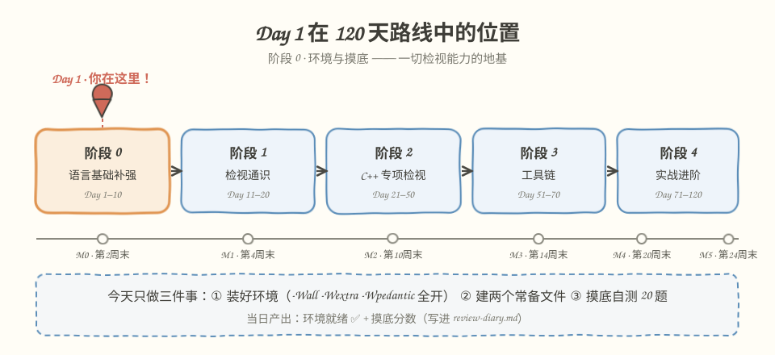
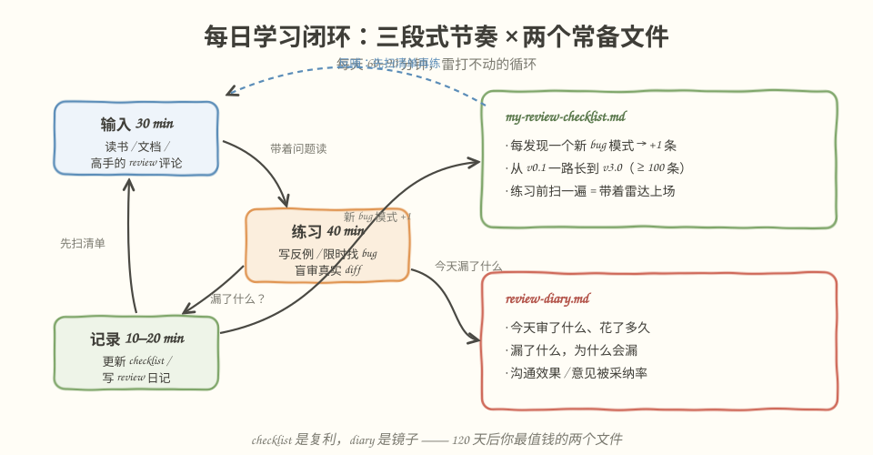
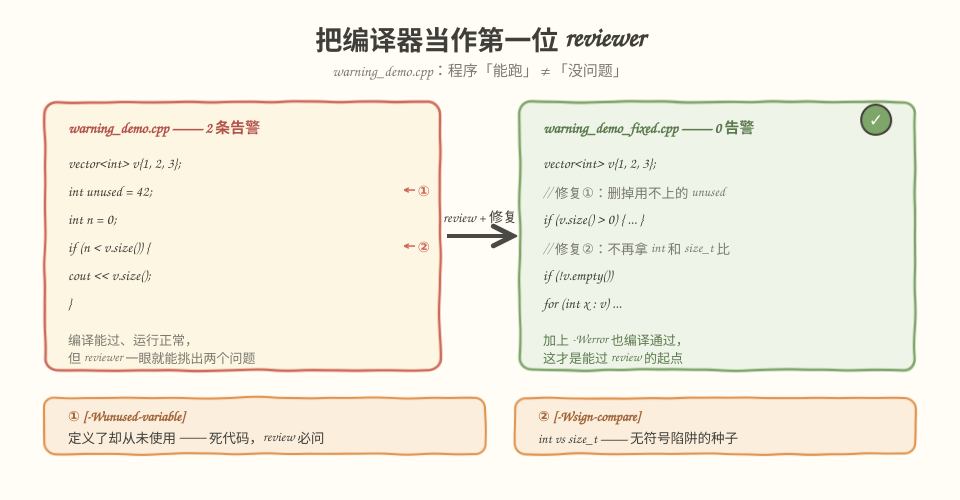

# Day 1 · 环境与摸底：让编译器成为你的第一位 reviewer

> **阶段 0 · 第 1 周** ｜ 当日计划：安装 GCC/Clang + Git；建好两个常备文件；做 20 项语言自测
> 预计用时 60–90 分钟 ｜ 当日产出：环境就绪 ✅ + 摸底分数（写进日记）

## 导语

学代码检视（Code Review），最容易走弯路的想法是："我要先去读别人的代码。"

顺序其实应该反过来。review 的第一课不是"看"，而是**让机器先替你挡住机械性的问题**——警告、风格、显而易见的错误。机器管得好的部分交出去，你的注意力才能留给真正需要人来判断的部分：生命周期、并发、设计取舍。

所以 Day 1 只做三件事：**装好一个"警告全开"的编译环境，建立两个陪伴你 120 天的文件，再用 20 道题摸清自己的起点。** 不写漂亮代码，不背语法，只把"地基"夯实。



*图 1：Day 1 是 120 天路线的起点。今天不追求学会任何高深知识，只要求环境 100% 就绪、摸底分数如实记录——诚实的一张底片比虚假的好起点重要得多。*

## 前置补给

只补两个今天必须知道的事实，其他概念后面按天展开：

1. **编译器警告（warning）与错误（error）是两回事。** 错误让编译失败，警告只是"提醒"。默认配置下提醒很少，所以我们手动打开 `-Wall -Wextra -Wpedantic` 这组开关，让编译器尽可能多嘴——多嘴的编译器就是免费的初级 reviewer。
2. **macOS 上 `g++` 不是 GCC。** 它是 clang 的别名（后面实测会看到两者版本号一模一样）。这不影响入门学习，但当你将来验证"GCC 和 Clang 行为是否一致"时，必须知道自己在用哪个编译器。

## 概念讲解：你的学习环境由什么组成

### 1. 警告全开的编译器

三个开关，各管一段：

| 开关 | 作用 | 一句话理解 |
|---|---|---|
| `-Wall` | 常见问题：未使用变量、有符号/无符号比较等 | 编译器的"基本盘"意见 |
| `-Wextra` | 更细：参数未使用、基类缺少虚析构等 | 更挑剔的补充意见 |
| `-Wpedantic` | 严格按标准，拒绝非标准扩展 | "按 ISO 标准办" |

今天还会见到 `-Werror`（把警告升级为错误，用来验证"完全干净"）。注意：**老项目不建议一步到位开 `-Werror`**，警告太多会直接编译失败；正确姿势是新代码从第一天就全开，历史代码渐进治理（Day 51–52 专门讲）。

### 2. 三段式节奏与两个常备文件

每天 60–90 分钟怎么花？固定的三段式：**输入 → 练习 → 记录**。其中"记录"环节落到两个文件上，它们是整个 120 天里复利效应最强的两个资产。



*图 2：左上是每天的三段式循环；右侧两个文件是循环的沉淀池。checklist 越长，你下次练习的"雷达"越灵敏；diary 越诚实，你的复盘越有效。*

两个文件的初始模板（今天照抄建好即可）：

```markdown
<!-- my-review-checklist.md v0.1 -->
# 我的 C++ 检视清单

## 通用
- [ ] 变更是否附带测试？测试是否真的覆盖新行为？
- [ ] 命名与注释是否清楚？（不纠结风格，风格交给工具）

## 内存与资源
- [ ] 每个裸 new 的所有权去向是否明确？

## 记录
- v0.1 · Day 1 创建
```

```markdown
<!-- review-diary.md -->
# Review 日记

## Day 1 · 环境与摸底
- 审了什么：warning_demo.cpp 的两条告警
- 漏了什么：（自测后填写）
- 摸底分数：__/20
```

## 检视演练：亲手搭起来

> 以下命令均在仓库 `tutorials/day-001/examples/` 目录下实际执行过。
> 本机环境：macOS（Apple Silicon），Apple clang 21.0.0，git 2.56.0。

### 演练 1：跑环境自检脚本

[env_check.sh](examples/env_check.sh) 逐项检查编译器、C++ 标准支持和常用工具：

```bash
cd tutorials/day-001/examples
bash env_check.sh
```

实测输出（本机）：

```text
== 编译器 ==
  [PASS] clang++ : Apple clang version 21.0.0 (clang-2100.4.1.1)
  [PASS] g++     : Apple clang version 21.0.0 (clang-2100.4.1.1)
== C++ 标准支持探测 ==
  [PASS] -std=c++17 可用
  [PASS] -std=c++20 可用
  [PASS] -std=c++23 可用
== 常用工具 ==
  [PASS] git     : git version 2.56.0
  [PASS] python3 : Python 3.9.6

结果：7 项通过，0 项失败
环境就绪，可以开始 Day 1 的练习了 ✅
```

注意第一、二行：`g++` 和 `clang++` 的版本一模一样——这就是前面说的"macOS 上 g++ 是 clang 的别名"，我们用实测亲眼确认了。

### 演练 2：建两个常备文件

把上面两个模板分别保存为 `my-review-checklist.md` 和 `review-diary.md`，放在你自己的学习目录（不必放进本仓库）。今天结束时日记里要有一行摸底分数。

### 演练 3：第一个"干净"程序

[hello_review.cpp](examples/hello_review.cpp) 只有几行，但用最严格的开关编译：

```bash
clang++ -std=c++17 -Wall -Wextra -Wpedantic -Werror hello_review.cpp -o hello_review
./hello_review
```

实测输出：

```text
Hello, C++ Code Review!
（退出码 0）
```

`-Werror` 下零告警通过——这就是以后每个示例的基线。

### 演练 4：亲眼见到告警，再亲手消除

[warning_demo.cpp](examples/warning_demo.cpp) 能编译、能运行、输出正常，是"看起来没问题"的典型：

```bash
clang++ -std=c++17 -Wall -Wextra -Wpedantic warning_demo.cpp -o warning_demo
```

编译器的 stderr（实测原文）：

```text
warning_demo.cpp:11:9: warning: unused variable 'unused' [-Wunused-variable]
   11 |     int unused = 42;          // 问题 1：定义了却从未使用
      |         ^~~~~~
warning_demo.cpp:14:11: warning: comparison of integers of different signs: 'int' and 'size_type' (aka 'unsigned long') [-Wsign-compare]
   14 |     if (n < v.size()) {       // n 是 int，v.size() 是 size_t（无符号）
      |         ~ ^ ~~~~~~~~
2 warnings generated.
```

程序照常运行（`v 里有 3 个元素`）——**这就是关键教学点：能跑 ≠ 没问题。**

用 reviewer 的眼光逐条解读：

- **告警 ①（未使用变量）**：死代码。review 意见原型："Must fix：`unused` 定义后从未使用，删除；若是为后续预留，请连同注释一起提交后续 commit。"
- **告警 ②（有符号/无符号比较）**：`int` 与 `size_t` 比较，隐式转换规则可能在负数场景下产生反直觉结果——这是无符号陷阱的种子，Day 32 专题展开。review 意见原型："Should fix：用 `v.size() > 0` 或统一为 `size_t`，避免混用符号。"

修复版 [warning_demo_fixed.cpp](examples/warning_demo_fixed.cpp)：

```bash
clang++ -std=c++17 -Wall -Wextra -Wpedantic -Werror warning_demo_fixed.cpp -o warning_demo_fixed
./warning_demo_fixed
```

实测输出：

```text
v 里有 3 个元素
1 2 3
```



*图 3：左边两个橙色标记就是未来你写 review 意见时最常见的开场白。记住这个感受：编译器先把"肉眼可见的问题"报出来，你才有精力去想"机器看不出来"的问题。*

## 工具验证

- `env_check.sh` 的探测逻辑很朴素：`command -v` 查存在性，`-std=c++NN` 试编译探标准支持。你可以随意扩展（比如加 `clang-format --version`）。
- 本日所有命令的真实输出都已记录在上文，可复制环境后逐条对照。若你的环境告警文案与上文不同（编译器/版本差异），属正常现象，**但"-Wall -Wextra 下这两类问题会被报出"应当成立**。
- 把这些开关接入 CI 是第 11 周的事（Day 55），今天只要求本地手敲形成肌肉记忆。

## 常见错误与误判

1. **误判：我的 `g++` 就是 GCC。** macOS 上它只是 clang 别名（本日已实测）。影响：想对比两个编译器行为时结论会错。解法：装真正的 GCC（如 Homebrew 的 `gcc`，命令是 `g++-14` 之类）再对比。
2. **误判：程序跑对了就没问题。** warning_demo 跑得好好的，两条告警照样在。review 的直觉恰恰要建立在对"能跑"的不信任上——UB 类问题平时潜伏，优化一开就爆。
3. **坏习惯：嫌告警吵，加 `-w` 全关。** 等于把免费的 reviewer 开除了。正确做法是修告警，或对确认无碍的个别告警精确豁免（后面讲 `-Wno-xxx` 与 `NOLINT` 的分寸）。
4. **坏习惯：给历史项目一步到位上 `-Werror`。** 千行告警瞬间让构建瘫痪，团队会倒逼你回滚。渐进策略：先全开警告不拦构建，清零后再上 `-Werror`。
5. **自测环节的典型误判**：把"能编译"当成"定义良好"。后面 20 题里有多道答案是"未定义行为（UB）"——现在答错很正常，这正是我们要学的地图。

## 练习：20 项摸底自测

规则：**先在纸上/文件里写下你的答案，再展开对照**。只统计"核心结论答对"；解析看不懂的题目直接记进日记——它们就是你后面几周的路标。

1. `auto s = std::move(other);` 之后还能使用 `other` 吗？
2. `const` 成员函数里能修改成员变量吗？
3. RAII 的全称是什么？它解决什么问题？
4. 两个对象各持有一个指向对方的 `shared_ptr` 会怎样？怎么破？
5. `std::string_view sv = std::string("hi");` 下一行使用 `sv` 安全吗？
6. lambda 用 `[&]` 捕获局部变量后存起来稍后执行，安全吗？
7. `vector` 做 `push_back` 之后，之前保存的迭代器还有效吗？
8. 空容器上 `v.size() - 1` 得到什么？
9. 析构函数默认是 `noexcept` 的吗？
10. `return std::move(local);` 是性能优化吗？
11. 两个线程不加同步地对同一个 `int` 自增，程序"偶尔结果对"就没问题吗？
12. `new T[10]` 配 `delete p`（不带 `[]`）可以吗？
13. 基类析构函数不是 `virtual`，通过基类指针 `delete` 派生类对象会怎样？
14. `v.emplace_back(args...)` 和 `push_back(T(args...))` 的区别是什么？
15. 数据竞争必须"两个写同时发生"才算吗？
16. 形参是 `const std::vector<int>&`，函数里能调 `v.push_back(...)` 吗？
17. 标了 `noexcept` 的函数里抛出异常会怎样？
18. `int*` 指向的内存按 `float*` 强转后读写，合法吗？
19. `std::atomic<int> x;` 两个线程各自自增 100 次，最终值一定是 200 吗？
20. 为什么不能在头文件里写 `using namespace std;`？

<details>
<summary><strong>参考答案与解析（先答题再展开！）</strong></summary>

1. **能安全做的只有：赋新值、销毁；不能假设它的内容。** 移动后的对象处于"有效但未指定（valid but unspecified）"状态。这是 review 中"use-after-move"检查的理论基础。
2. **默认不能；标了 `mutable` 的成员可以。** `mutable` 的存在意义就是"物理可变、逻辑不变"（如缓存计数）。
3. **Resource Acquisition Is Initialization（资源获取即初始化）。** 把资源生命周期绑定到栈对象生命周期，析构自动释放，异常路径也不泄漏。整个 C++ 资源管理的基石。
4. **引用计数永不归零 → 内存泄漏；把其中一方改为 `weak_ptr` 打破环。** 观察者/父子结构的高发问题。
5. **不安全。** 右侧临时 `string` 在该语句结束时销毁，`sv` 悬垂。view/span 类型的铁律：不拥有数据，只借视图。
6. **不安全。** 按引用捕获的局部变量在 lambda 稍后执行时可能早已销毁。存储/异步场景优先按值捕获或显式管理生命周期。
7. **不保证。** 触发扩容则全部失效；未扩容时指向元素的迭代器/引用仍有效。结论：`push_back` 后旧迭代器一律视为可疑。
8. **不是 -1。** `size()` 是无符号类型，`0 - 1` 回绕为 `SIZE_MAX` 级别的巨大数，再用它做下标就是 UB。
9. **是。** 析构函数隐式 `noexcept`，从中抛异常会直接 `std::terminate`。
10. **不是，反而抑制 RVO/NRVO。** 直接 `return local;` 编译器才能做返回值优化。
11. **不行。** 数据竞争本身就是 UB，"看起来对"毫无证明力。
12. **不可以，UB。** 数组形式必须配 `delete[]`。
13. **UB（实践中通常只析构基类部分，派生类资源泄漏）。** 多态基类要声明虚析构。
14. **`emplace_back` 在容器内存中原地构造，省去临时对象及其移动/拷贝。**
15. **不是。** 只要"至少一个写 + 至少一个读或写 + 无同步顺序约束"就是竞争。
16. **不能。** `const` 对象上不能调用非 `const` 成员函数。
17. **`std::terminate` 直接终止，栈不展开。** `noexcept` 是硬承诺，不是优化建议。
18. **不合法（违反 strict aliasing，UB）。** 类型双关要走 `memcpy` 或 `bit_cast`（C++20）。
19. **会。** `atomic` 的自增是原子读改写（RMW），不丢更新；换成普通 `int` 才会丢。（注意：原子 ≠ 有顺序，内存序是另一个维度，Day 38 讲。）
20. **会把命名空间污染强加给所有包含它的翻译单元**，造成名字冲突与歧义。
</details>

**评分与走法：**

| 得分 | 判断 | 建议 |
|---|---|---|
| ≥ 15 | 基础扎实 | 阶段 0 快速通过（可合并每天 2 天量），重心放阶段 2/4 |
| 8–14 | 标准起点 | 按计划正常推进 |
| < 8 | 完全正常 | 阶段 0 每天不压缩，练透再走；宁慢勿虚 |

## 验收清单

- [ ] `bash env_check.sh` 全部 PASS（或失败项已修复）
- [ ] `my-review-checklist.md` 与 `review-diary.md` 已创建
- [ ] `hello_review.cpp` 在 `-Werror` 下编译通过
- [ ] 能不看资料说出 warning_demo 两条告警"为什么是问题、怎么改"
- [ ] 20 题摸底完成，分数已写进日记，看不懂的题号已标记

## 总结

今天你完成了三件事：一个**警告全开**的编译环境（编译器从此是你的第一位 reviewer）、两个将陪伴 120 天的**常备文件**（checklist 与日记）、一张诚实的**摸底底片**（20 分制）。从明天起进入真正的语言地基：Day 2 我们学 RAII，亲手实现一个 `FileGuard`，并故意用异常路径验证"为什么裸资源管理在 C++ 里是原罪"。

---

*上一日：无（今天是起点） ｜ [返回教程索引](../README.md) ｜ 下一日：Day 2 · RAII 与 FileGuard（待生成）*
