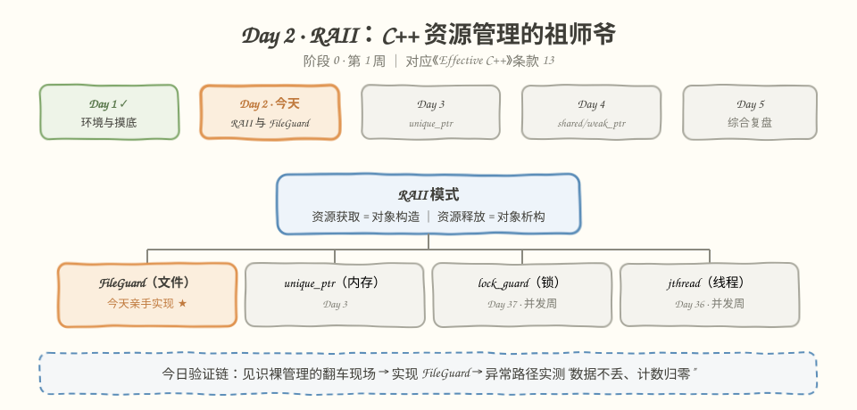
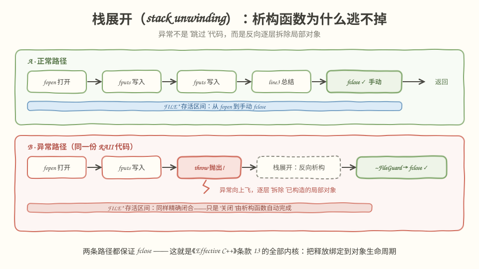
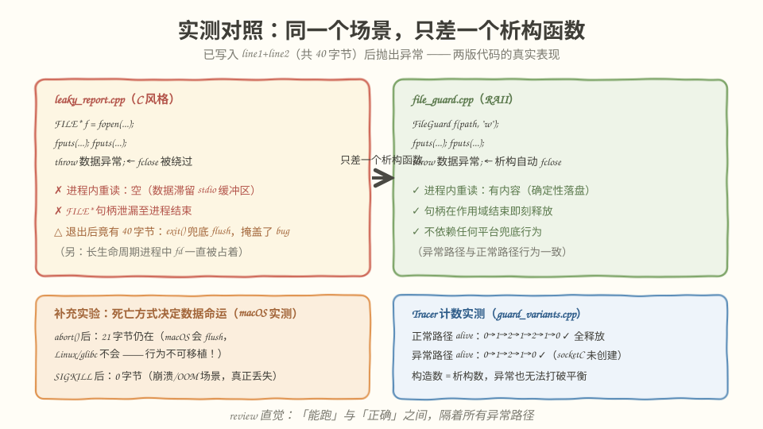

# Day 2 · RAII 与 FileGuard：把"释放"绑定到对象的生命周期

> **阶段 0 · 第 1 周** ｜ 当日计划：读《Effective C++》条款 13；实现 `FileGuard`（构造打开 / 析构关闭）；故意抛异常验证泄漏被消除
> 预计用时 60–90 分钟 ｜ 当日产出：3 个实测示例 + review 笔记（写进日记）

## 导语

昨天的 warning_demo 告诉你：编译器能帮你抓"写错的表达式"。但有一大类问题编译器**永远不吭声**——资源泄漏。文件打开了没关、内存要了没还、锁拿了没放。这类代码平时跑得好好的，直到某个深夜的异常路径让它现出原形。

C++ 对这个问题的回答叫 **RAII**。它不是某个库或关键字，而是一个只有一句话的模式：

> **资源的获取绑定到对象构造，资源的释放绑定到对象析构。**

今天的路线：先亲眼看到一个"能跑的代码"如何在异常面前丢数据，再写一个 20 行的 `FileGuard` 让同样的事故不可能发生，最后用计数器证明"构造数 = 析构数"在异常下依然成立。



*图 1：RAII 是所有资源管理类的祖师爷。今天手写 `FileGuard` 不是为了替代标准库，而是为了让你在 review 里能一眼认出"这里缺一个 guard"以及"这个 guard 写得对不对"。*

## 前置补给

1. **`FILE*` 与 stdio 缓冲区**：`fopen` 拿到的是 C 标准库的文件句柄；`fputs` 写的数据先进**用户态缓冲区**（典型 4KB），`fflush`/`fclose` 才真正落盘。这个细节是今天所有实验的舞台。
2. **栈展开（stack unwinding）**：异常抛出后，运行时从抛出点向外**反向逐层销毁**已构造完成的局部对象，直到进入某个 `catch`。局部对象的析构函数因此"必然获得一次执行机会"——RAII 全部建立在这件事上。
3. 术语：**资源（resource）** 泛指任何"获取后必须归还"的东西——内存、文件句柄、锁、socket、线程，甚至"临时提高的日志级别"。

## 概念讲解

### 1. 裸管理的根本缺陷：路径爆炸

"谁打开谁关闭"在纸面上完美。但一个函数有 N 个出口（多个 `return`、每个可能抛异常的调用、循环里的 `break`），释放代码只有一份在末尾——**出口数量 × 释放点数量**的组合里，只要有一条路径漏掉，就是泄漏。人脑 review 裸管理代码时最大的负担正是"枚举所有路径"。

### 2. RAII 的机制：把释放挂到"必然发生"的事件上

对象析构在 C++ 里是**语言保证**的事件：作用域正常结束会析构，栈展开也会析构。所以只要释放代码写在析构函数里，就不用再枚举任何路径——**一次绑定，全路径覆盖**。



*图 2：注意面板 B 里 FILE* 的存活区间同样精确闭合——区别只是"关闭"从手动调用变成了自动发生。RAII 不改变资源语义，只改变"谁负责在何时调用释放"。*

### 3. 最小可用的 FileGuard

```cpp
class FileGuard {
public:
    explicit FileGuard(const char* path, const char* mode)
        : f_(std::fopen(path, mode)) {
        if (f_ == nullptr) throw std::runtime_error("open failed");
    }
    ~FileGuard() { if (f_) { std::fclose(f_); f_ = nullptr; } }
    FileGuard(const FileGuard&) = delete;             // 拷贝会导致双重关闭
    FileGuard& operator=(const FileGuard&) = delete;
    FILE* get() const { return f_; }
private:
    FILE* f_;
};
```

review 这个类时的三个要点：

- **构造函数里检查打开失败并抛异常**——不把"无效对象"放出去；
- **拷贝被 `delete`**：两个 guard 持有同一个 `FILE*`，析构两次就是双重关闭（UB）。所有权的转移（移动）是明天的主题（`unique_ptr`）；
- **`get()` 只作只读访问**，拿到裸指针存到别处 = 逃离 guard 保护（Day 24 专题）。

## 检视演练：三个实测

> 环境同 Day 1：Apple clang 21.0.0，`-std=c++17 -Wall -Wextra -Wpedantic`，0 告警编译。
> 完整源码见 [examples/](examples/)，以下输出均为**真实运行记录**。

### 演练 1：翻车现场 —— [leaky_report.cpp](examples/leaky_report.cpp)

C 风格写报告，写完两行后因"数据异常"抛出，`fclose` 被绕过：

```bash
clang++ -std=c++17 -Wall -Wextra -Wpedantic leaky_report.cpp -o leaky_report
./leaky_report                      # 模式一：异常被 main 捕获
```

实测输出：

```text
caught: 数据异常，中止写报告
重开文件读取: （空！缓冲区里的数据全丢了）
```

**进程内**重读文件是空的——两行数据还躺在 stdio 缓冲区里，没人 `fclose`。

但这里有个**必须诚实交代的转折**：程序正常退出后再看磁盘——

```text
进程退出后文件大小: 40 字节   ← exit() 把泄漏的流也 flush 了！
```

ISO C 规定正常终止时要关闭所有打开的流，所以这 40 字节是 `exit()` 的"临终善后"——它恰好掩盖了 bug（列表文件大小看起来正常）。那数据到底会不会真丢？再跑模式二和两个补充实验：

```bash
./leaky_report --uncaught          # 模式二：异常无人捕获 → terminate → abort
```

实测：`libc++abi: terminating due to uncaught exception`，退出码 134，退出后文件仍有 40 字节——**macOS 的 `abort()` 恰好会 flush stdio**。用一个最小 C 实验直接验证"死亡方式"的影响（`fputs` 后不 `fclose` 直接死亡）：

| 死亡方式 | 文件大小（实测） | 说明 |
|---|---|---|
| 正常 `exit` | 21 字节 | 标准要求 flush 所有流 → **掩盖泄漏** |
| `abort()`（本机 macOS） | 21 字节 | macOS libc 特有；**glibc/Linux 不会 flush**，行为不可移植 |
| `SIGKILL`（模拟崩溃/OOM） | **0 字节** | 内核直接回收，缓冲区蒸发 → **数据永久丢失** |

结论：裸管理的真实代价 = 进程内数据不可见的窗口期 + 句柄泄漏（长生命周期进程里 fd 被占死）+ 把正确性押注在"进程怎么死"这种你控制不了的细节上。

### 演练 2：FileGuard 版 —— [file_guard.cpp](examples/file_guard.cpp)

同样的场景，只把裸 `FILE*` 换成 `FileGuard`：

```bash
./file_guard
```

实测输出：

```text
caught: 数据异常，中止写报告
重开文件读取: 有内容！异常也没丢数据
```

异常照抛、`catch` 照接，但 `~FileGuard()` 在栈展开时已经把 `fclose` 做完——数据确定性落盘，句柄即时释放，行为不依赖平台兜底。



*图 3：左右两版代码只差一个析构函数。review 时你看到的往往不是完整实验，而是 diff 里那一行 `FileGuard f(...)`——今天的实验就是让你对这一行的价值有肌肉记忆。*

### 演练 3：RAII 的普适性 —— [guard_variants.cpp](examples/guard_variants.cpp)

`Tracer` 用一个静态计数器模拟任意资源（构造 = 获取，析构 = 释放），在嵌套作用域 + 异常下验证"构造数 = 析构数"：

```bash
./guard_variants
```

实测输出：

```text
[1] 正常路径：
    获取 内存块A（存活 1）
    获取 锁L（存活 2）
    释放 锁L（存活 1）
    获取 socketC（存活 2）
    释放 socketC（存活 1）
    释放 内存块A（存活 0）
  结束时 alive = 0（应为 0）
[2] 异常路径（在 b 作用域内抛出）：
    获取 内存块A（存活 1）
    获取 锁L（存活 2）
    释放 锁L（存活 1）
    释放 内存块A（存活 0）
  caught: boom
  结束时 alive = 0（应为 0）
```

注意异常路径的两个细节：**`socketC` 根本没被创建**（throw 之后的代码没执行），已构造的对象**逆序释放**（锁L 先于 内存块A）。这个"逆序"就是栈展开的方向，也是嵌套资源不会乱序释放的原因。

## 工具验证

- 三个示例全部 `-Wall -Wextra -Wpedantic` 下 **0 告警**编译（过程中还真实踩了一脚：`main` 参数注释写法不当触发编译错误、未使用参数触发告警——已修复，这正是"教程也要过 review"的小小彩蛋）。
- 验证泄漏的通用手段备忘：今天的静态计数器是最轻量的；Day 13 起会认识 **ASan（`-fsanitize=address` 的 LeakSanitizer）**，它能直接报 `fclose` 缺失类泄漏；fd 泄漏可用 `lsof -p <pid>` 观察。
- 想复跑实验：`cd tutorials/day-002/examples` 后按各文件头注释的命令执行即可（输出文件生成在当前目录）。

## 常见错误与误判

1. **误判：没有 `new` 就没有泄漏。** `FILE*`、fd、`pthread_mutex_lock`、socket、甚至"临时关掉的调度器"都是资源。review 的雷达要按"获取-释放对"扫描，不是按"有没有 new"。
2. **误判：把 `fclose` 放在函数末尾就安全了。** 演练 1 已经现场打脸：一个 `throw` 就绕过。同理适用于"末尾 unlock"。
3. **误判：RAII = 智能指针。** 智能指针只是 RAII 在内存上的特化。看到手写 guard 类不要觉得"土"——标准库没覆盖的资源类型多得很。
4. **危险写法：在析构函数里抛异常。** 栈展开中再抛 = `std::terminate`（Day 43 专题）。guard 的析构必须吞下或记录错误，绝不外抛。
5. **误判：拷贝一个 guard 没什么。** 双重 `fclose` 是 UB。正确做法就是今天这样 `= delete` 拷贝；需要转移所有权时写移动语义（明天 `unique_ptr` 的主题）。
6. **误判：异常是罕见路径，可以先不管。** 恰恰相反——任何 `fopen`/`malloc`/构造调用都可能抛或失败，"罕见路径"才是 review 的主战场。

## 练习

1. **改坏它**：把 `FileGuard` 析构里的 `fclose` 注释掉，重跑 `file_guard`，观察哪条输出变化（预期：与 leaky 行为一致）。改回来，感受"一行定生死"。
2. **换资源**：照 `FileGuard` 的骨架写一个 `MutexGuard`（构造 `pthread_mutex_lock`，析构 unlock）或 `SocketGuard`。写完自问：拷贝删了吗？构造失败路径呢？
3. **review 实操**：假装 review [leaky_report.cpp](examples/leaky_report.cpp) 的 diff，写出 3 条意见并标级别。参考：Must fix —— "异常/提前返回路径绕过 `fclose`，数据滞留缓冲区、句柄泄漏，建议引入 guard 类"；Should fix —— "打开失败应向上传播为异常而非静默返回"；Nit —— "魔法字符串 `report_leaky.txt` 提取为常量"。写完和同事/朋友互评措辞是否"对事不对人"。
4. **口述检验**：不看资料，向空气解释"栈展开为什么会调用析构函数、调用顺序是什么"。

## 验收清单

- [ ] 能 30 秒说出 RAII 那句"一个模式"并解释它为何覆盖所有路径
- [ ] 亲手跑过 leaky 两种模式 + file_guard，亲眼见过"空 vs 有内容"
- [ ] 能解释为什么"退出后 40 字节"反而是 bug 被掩盖的证据
- [ ] `FileGuard` 的三个 review 要点（构造抛异常 / 删拷贝 / get 不外存）能复述
- [ ] `guard_variants` 的"逆序释放、未创建不析构"两细节能解读
- [ ] 练习 3 的 review 意见已写进 `review-diary.md`
- [ ] checklist 新增 ≥5 条 RAII 类条目（如"每个 fopen/malloc/lock 都有对应 guard 或明确注释说明为何不需要"）

## 总结

今天你把"资源释放"从**人的责任心**移交给了**语言保证**：翻车现场（数据丢失、句柄泄漏、平台差异兜底）→ FileGuard 20 行根治 → Tracer 证明异常下计数依然归零。从 review 视角，你获得了一个新的扫描模式：**看到"获取"，立刻找"guard"**。

明天 Day 3 进入所有权的第一站：`unique_ptr`——移动语义如何让"guard 们"可以被安全地转移、放进容器、从工厂函数返回。

---

*[返回教程索引](../README.md) ｜ 上一日：[Day 1 · 环境与摸底](../day-001/README.md) ｜ 下一日：Day 3 · unique_ptr 与移动语义（待生成）*
