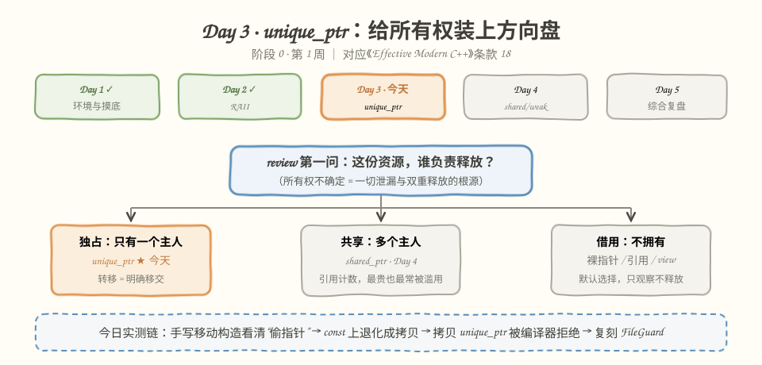
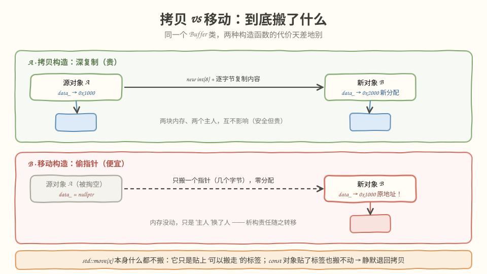
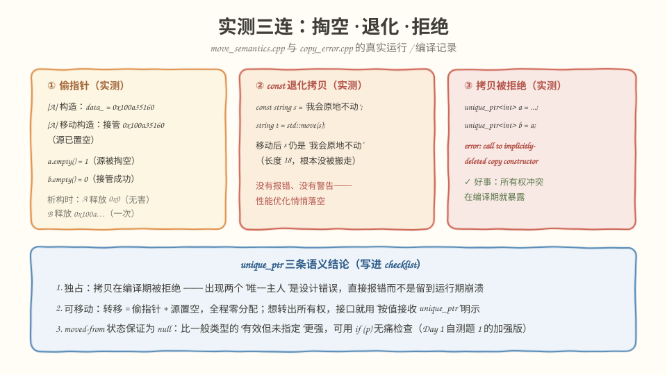

# Day 3 · unique_ptr 与移动语义：让所有权可以安全转移

> **阶段 0 · 第 1 周** ｜ 当日计划：读《EMC++》条款 18；实现持有 `unique_ptr` 的资源池；实验：unique_ptr 不可拷贝、可移动
> 预计用时 60–90 分钟 ｜ 当日产出：3 个实测示例 + 独占所有权三条语义结论

## 导语

昨天的 `FileGuard` 有一个刻意留下的限制：**它只能"生老"在当前作用域里**。想把它存进容器、从工厂函数返回、交给另一个模块——都不行，因为拷贝被删了，而"转移"我们还没写。

今天的主角 `unique_ptr` 补上这块拼图：它是**独占所有权的标准表达**，靠"移动语义"实现所有权的转移。理解它的最佳路径不是背 API，而是**亲手写一次移动构造函数**——亲眼看到"偷指针 + 源置空"这 6 个字如何同时消灭"泄漏"和"双重释放"。



*图 1：从今天起你有了 review 资源代码的第一问："这份资源，谁负责释放？"答案只有三种：独占、共享、借用。默认应该是"独占或借用"——shared_ptr 是明天的话题，也是最常见的过度设计。*

## 前置补给

1. **moved-from 状态**（Day 1 自测题 1 的加强）：一般类型被移动后处于"有效但未指定"状态；而 `unique_ptr` 给出**更强保证：移动后必为空**。所以 `if (p)` 检查是安全且惯用的。
2. **`std::move` 不是移动**：它是一个类型转换（把左值转成右值引用），本身一个字节都不搬。真正干活的是随后被重载决议选中的**移动构造/移动赋值**。今天会在实测里看到它"失效"的样子。
3. 术语：**所有权（ownership）** = "谁负责释放"；**转移（transfer/move）** = 所有权换人；**借用（borrow）** = 临时使用、不负责释放（裸指针/引用/`view`）。

## 概念讲解

### 1. 移动 vs 拷贝：机制上到底差在哪

```cpp
Buffer(const Buffer& o)  : data_(new int[8]{})        { /* 深复制 o.data_ */ }
Buffer(Buffer&& o) noexcept : data_(o.data_) { o.data_ = nullptr; }   // 偷指针
```

- **拷贝**：分配新内存、逐字节复制 → 两块内存、两个主人，安全但贵；
- **移动**：把源对象的指针"偷"过来，再把源置空 → 零分配，**析构责任随之转移**——源再析构时是 `delete[] nullptr`（无害空操作），新主人负责最终释放。



*图 2：注意底部那行字——`std::move` 遇上 `const` 对象时"标签"失效，静默退回拷贝。这是今天实测 ② 的主角，也是 review 中的高频暗坑。*

### 2. unique_ptr 的接口语义

| 操作 | 语义 | review 意义 |
|---|---|---|
| 拷贝 | **编译期拒绝** | 所有权冲突在编译期暴露，而不是运行期双重释放 |
| 移动 | 偷指针 + 源置空 | `auto b = std::move(a);` 后 `a` 保证为 null |
| 按值传参 | 调用方**交出**所有权 | 函数签名本身就是文档："我要拿走它" |
| 按值返回 | 所有权交给调用方 | 工厂函数的标准姿势（RVO 优化掉移动本身） |
| `make_unique<T>(...)` | 安全构造 | 避免裸 `new`（见"常见误判"第 2 条） |

### 3. 用自定义删除器复刻 FileGuard

```cpp
struct FileCloser {
    void operator()(FILE* f) const { if (f) std::fclose(f); }
};
using FilePtr = std::unique_ptr<FILE, FileCloser>;
```

昨天手写 20 行的类，今天一行类型别名搞定——而且**天生可移动**。这是"标准库没有的资源类型"接入 RAII + 移动语义的通用方法。

## 检视演练：四个实测

> 环境同前：Apple clang 21.0.0，`-std=c++17 -Wall -Wextra -Wpedantic`，0 告警。
> 源码在 [examples/](examples/)，输出均为真实记录（地址每次运行不同）。

### 演练 1：资源池与所有权流转 —— [unique_basics.cpp](examples/unique_basics.cpp)

工厂函数创建、`std::move` 转移、按值传参交接、装进 `vector` 池：

```bash
./unique_basics
```

实测输出：

```text
[1] make_unique 创建 + std::move 转移：
  [获取] 连接 db 建立
    移动后 a=空（unique_ptr 移动后保证为空）, b->name=db
[2] 按值传参交给 handoff（= 交出所有权）：
  [交接] 现在由 handoff 持有 db
  [释放] 连接 db 关闭
    b=空（所有权已不在我们手里）
[3] 装进资源池：
  [获取] 连接 redis 建立
  [获取] 连接 kafka 建立
[4] main 结束，观察释放顺序：
  [池析构] 池内还有 2 个连接，逐一释放
  [释放] 连接 kafka 关闭
  [释放] 连接 redis 关闭
```

三个 review 级别的观察点：移动后 `a` **保证为空**（unique_ptr 的强承诺）；`handoff` 结束即释放（所有权在哪，释放就在哪）；**池析构按逆序释放**（kafka 先于 redis）——和昨天 Tracer 的逆序规律一致，这是栈/容器析构的普适法则。

### 演练 2：手写移动构造 + const 陷阱 —— [move_semantics.cpp](examples/move_semantics.cpp)

```bash
./move_semantics
```

实测输出：

```text
[1] 手写移动构造，观察“偷指针”：
  [A] 构造：data_ = 0x100a35160
  [A] 移动构造：接管 0x100a35160，源已置空
    a.empty() = 1（源被掏空）, b.empty() = 0
[2] std::move 遇上 const：静默退化成拷贝！
    移动后 s 仍是 "我会原地不动"（长度 18，根本没被搬走）
[3] 编译期性质对照：
    Buffer     可拷贝？1 ｜ 可移动？1
    unique_ptr 可拷贝？0 ｜ 可移动？1
  [A] 析构：释放 data_ = 0x100a35160
  [A] 析构：释放 data_ = 0x0
```

读三遍最后两行析构日志：接管者释放 `0x100a…`（真内存），被掏空的源释放 `0x0`（空操作）——**一次分配恰好一次释放**，这就是移动语义消灭"双重释放"的现场证据。而 `[2]` 展示了暗坑：`const string` 上 `std::move` 不报错不警告，默默退回拷贝——**性能优化悄悄落空**（review 时看到 `const` 成员/变量被 move，就是一条 Should fix）。

### 演练 3：拷贝被编译器拒绝 —— [copy_error.cpp](examples/copy_error.cpp)

这个文件**故意写错**，编译它（预期失败）：

```bash
clang++ -std=c++17 -Wall -Wextra -Wpedantic copy_error.cpp -o copy_error
```

实测报错（真实原文）：

```text
copy_error.cpp:9:26: error: call to implicitly-deleted copy constructor of 'std::unique_ptr<int>'
    9 |     std::unique_ptr<int> b = a;      // ← 拷贝 = 出现第二个“唯一”主人，编译期拒绝
      |                          ^   ~
note: copy constructor is implicitly deleted because 'unique_ptr<int>' has a user-declared move constructor
1 error generated.
```

把报错当好消息读：**所有权冲突在编译期就暴露了**。对比共享所有权：`shared_ptr` 允许拷贝，同样的错误要等到运行期（循环引用泄漏、控制块开销）才显现。这就是"独占优先"的设计理由。

### 演练 4：unique_ptr 复刻 FileGuard —— [unique_file.cpp](examples/unique_file.cpp)

昨天的异常写文件场景，用 `unique_ptr<FILE, FileCloser>` 重做：

```bash
./unique_file
```

实测输出：

```text
  [删除器] fclose 已执行
caught: 数据异常
重开文件读取: 有内容（异常路径照样落盘）
```

自定义删除器 + 移动语义 = 通用的"RAII 机器"：任何 `open/close` 型资源都能套用，且比手写 guard 类更省代码、天生可转移。



*图 4：把这三条结论抄进你的 my-review-checklist.md——它们是审一切"所有权代码"的底座。*

## 工具验证

- 四个示例编译状态：三个正常示例 **0 告警**；`copy_error.cpp` 按预期**编译失败**（这就是它的功能）。教学仓库里"预期失败的文件"要在注释里写明，避免误用——这本身也是 review 细节。
- `std::is_copy_constructible_v` / `is_move_constructible_v` 是编译期自检的好工具：给自己的资源类加一行 `static_assert(!std::is_copy_constructible_v<Guard>)`，让"不可拷贝"从约定变成契约。
- 预告：Day 12 会遇到 clang-tidy 的 `modernize-make-unique`，它会自动指出裸 `new` 应改用 `make_unique`。

## 常见错误与误判

1. **误判：`std::move` 会搬东西。** 它只是贴标签（左值→右值引用的转换）。搬东西的是移动构造/赋值；没有可用的移动构造（典型：`const` 对象）就静默退回拷贝——实测 ② 已验证。
2. **坏习惯：`unique_ptr<T>(new T(...))`。** 在 `f(unique_ptr<T>(new T), mayThrow())` 的求值间隙里，如果 `mayThrow()` 抛异常，裸指针没人接管 → 泄漏（求值顺序在 C++17 已收紧，但 `make_unique` 依然更简洁、更难写错）。规则：**能用 `make_unique` 就不用 `new`**（《EMC++》条款 21）。
3. **误判：移动后的对象"空了所以坏了"。** 它是有效对象，可以赋新值、可以析构、`if (p)` 可查。真正禁止的是"假设它还有旧内容"。
4. **坏味道：函数按 `const unique_ptr<T>&` 接收。** 你只是想用对象，却强迫调用方造一个 unique_ptr。只借用就用 `T&` 或 `const T&`；要接管就按值 `unique_ptr<T>`。`unique_ptr&` 出现在参数列表里，几乎总是签名设计错误。
5. **坏习惯：`p.get()` 的裸指针存到别处。** guard 的保护范围到 `get()` 返回值逃逸那一刻就结束了（Day 24 专题）。`get()` 只应作为"立刻用完"的桥接（如传给 C API）。
6. **误判：容器里放 `unique_ptr` 是过度设计。** 恰恰相反——`vector<unique_ptr<T>>` 是"池拥有多态对象"的标准形态；放裸指针才是把释放责任悬空。

## 练习

1. **补移动赋值**：给 `move_semantics.cpp` 的 `Buffer` 补上移动赋值运算符（注意自赋值防护：先释放自己的、再偷对方的）。用日志验证。
2. **改坏它**：把移动构造里的 `o.data_ = nullptr;` 注释掉，重新编译运行，观察"双重释放"在哪个日志行现形（提示：两行析构释放同一地址；正式工具是 ASan，Day 13 见）。
3. **review 实操**：审这段签名并写意见——`void process(const std::unique_ptr<Widget>& w);`。参考：Should fix——"若只需使用 Widget，改为 `const Widget&`；若需接管所有权，按值接收 `unique_ptr<Widget>`；当前写法既不能转移又绑架了调用方"。
4. **口述检验**：解释"为什么 `vector<unique_ptr<Conn>>` 能 push_back 而 `vector<FileGuard>`（昨天删掉拷贝、没写移动的版本）不能"。

## 验收清单

- [ ] 能画出"拷贝 vs 移动"的内存示意图（两块内存 vs 一块内存换主人）
- [ ] 亲眼见过"源置空 → 析构 0x0"的运行证据
- [ ] 能解释 `std::move` 遇到 `const` 时发生了什么、为什么危险
- [ ] 看过真实的"拷贝被拒绝"编译错误并理解为什么这是好事
- [ ] 能用自定义删除器把任意 open/close 资源包成 `unique_ptr`
- [ ] 三条语义结论已写进 checklist，练习 3 的 review 意见已写进日记

## 总结

今天你把"所有权"从静态的 RAII 绑定升级成了**可流转的一等公民**：转移即偷指针、独占即禁拷贝、工厂即按值返回。review 视角新增两个扫描点：看到 `new` 就问"为什么不是 `make_unique`"，看到 `unique_ptr<T>&` 参数就问"到底想借用还是想接管"。

明天 Day 4 处理所有权的另一极：`shared_ptr` / `weak_ptr`——引用计数怎么工作、循环引用如何让昨天学的一切"归零失效"，以及为什么"到处 shared_ptr"是最常见的过度设计。

---

*[返回教程索引](../README.md) ｜ 上一日：[Day 2 · RAII 与 FileGuard](../day-002/README.md) ｜ 下一日：Day 4 · shared_ptr 与 weak_ptr（待生成）*
