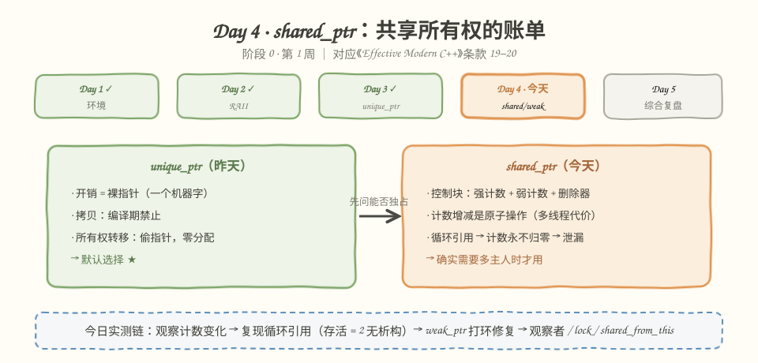
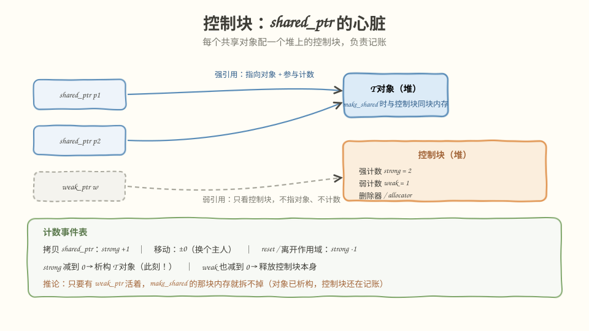
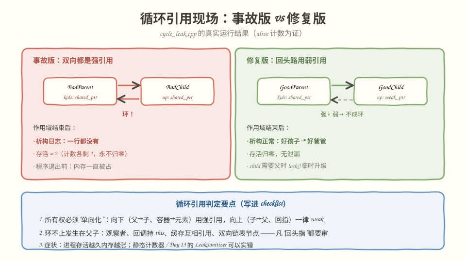

# Day 4 · shared_ptr / weak_ptr：共享所有权与循环引用

> **阶段 0 · 第 1 周** ｜ 当日计划：读《EMC++》条款 19–20；写循环引用示例（Parent/Child），用 weak_ptr 修复；观察控制块
> 预计用时 60–90 分钟 ｜ 当日产出：3 个实测示例 + 循环引用判定要点

## 导语

昨天的 `unique_ptr` 用一行铁律管理世界：**一个资源只有一个主人**。但现实里有些资源确实要多人共享：一张配置表、一个连接池、一份缓存。C++ 的答案是 `shared_ptr`——用**引用计数**实现"最后一个走的人关灯"。

听起来很美，代价也真实：每个共享资源要多一块**控制块**，计数增减是**原子操作**，而最阴险的是——**两个 shared_ptr 互相抱着，计数永远到不了 0，昨天学的全部 RAII 机制集体失灵**。今天我们就亲手制造这个事故，再亲手修好它。



*图 1：review 的默认立场：先问"能不能 unique"，确实需要多主人再上 shared。"到处 shared_ptr"是最常见的过度设计——它让所有权图变成一团雾。*

## 前置补给

1. **控制块（control block）**：每个被 shared_ptr 管理的资源在堆上配一个记账本：强计数（多少个 shared_ptr）+ 弱计数（多少个 weak_ptr）+ 删除器。`make_shared` 会把对象和控制块合并在一次分配里。
2. **强计数归零 → 析构对象；弱计数也归零 → 释放控制块**。这两步是分开的——这就是 weak_ptr "不延长对象生命、但会延长控制块内存"的原因。
3. 术语：**强引用** = shared_ptr（拥有）；**弱引用** = weak_ptr（观察）；**环（cycle）** = 强引用链首尾相接。

## 概念讲解

### 1. 引用计数怎么记账

- 拷贝一个 shared_ptr：strong +1（原子操作，多线程下有代价）；
- 移动：±0，只换主人（和昨天 unique_ptr 的"偷指针"一致）；
- 每个引用者离开作用域 / reset：strong -1；
- strong 减到 0 的那一刻：析构对象。



*图 2：注意弱引用那条虚线——weak_ptr 只看控制块、不指对象、不加强计数。它在回答一个问题："对象还活着吗？"（expired）以及"借我用一下"（lock）。*

### 2. 循环引用：为什么 RAII 失灵

`Parent` 持有 `shared_ptr<Child>`（合理：父拥有子），`Child` 又持有 `shared_ptr<Parent>`（回头指）→ 强引用成环。作用域结束时：局部变量把计数各减 1，但**环内还各剩 1 个引用**——没有"最后一个走的人"，灯永远不关。对象没泄漏到"找不到"，它们互相找得到，**只是没人负责释放**。

### 3. weak_ptr 修复原则

**所有权单向化：向下强、向上弱。** 子对象需要"知道"父对象时用 `weak_ptr<Parent>`——不计数、不成环；真正要访问时 `lock()` 临时升级为强引用（顺带原子地确认对象还活着），用完即还。

## 检视演练：三个实测

> 环境同前：Apple clang 21.0.0，`-std=c++17 -Wall -Wextra -Wpedantic`，0 告警。
> 源码在 [examples/](examples/)，以下输出均为真实运行记录。

### 演练 1：观察计数变化 —— [control_block.cpp](examples/control_block.cpp)

```bash
./control_block
```

实测输出：

```text
[1] 计数随 拷贝/移动/作用域 变化：
  [构造] Doc 报告
  创建后    use_count = 1
  拷贝后    use_count = 2
  移动后    use_count = 2
  [析构] Doc 报告
  内层作用域结束，Doc 已析构（见上方日志）
[2] 容器与局部变量共享同一份资源：
  [构造] Doc 合同
  入容器×2 use_count = 3
  容器清空 use_count = 1
  [析构] Doc 合同
[3] 最后一个引用者负责释放：
  [构造] Doc 尾声
  first 已离开，Doc 仍存活（last 持有）
  [析构] Doc 尾声
main 结束
```

三个观察点：**移动后计数不变**（2，只是换了主人）；容器里两份 + 局部一份 = 3；`[3]` 里 first 离开作用域 Doc 却活着——因为 last 还举着灯。**对象生命周期 = 最长引用者的作用域**，这是共享所有权的本质，也是它最难推理的地方。

### 演练 2：循环引用事故与修复 —— [cycle_leak.cpp](examples/cycle_leak.cpp)

```bash
./cycle_leak
```

实测输出：

```text
[1] 事故现场：双向 shared_ptr 成环
  [构造] 坏爸爸（存活 1）
  [构造] 坏孩子（存活 2）
  离开作用域前：use_count(parent) = 2, use_count(child) = 2
  作用域已结束 —— 析构日志一行都没有！存活对象 = 2
[2] 修复：回头路改用 weak_ptr
  [构造] 好爸爸（存活 3）
  [构造] 好孩子（存活 4）
  离开作用域前：use_count(parent) = 1（弱引用不计数）
  child 借 lock() 访问 parent：好爸爸
  [析构] 好孩子（存活 3）
  [析构] 好爸爸（存活 2）
  作用域已结束 → 正常析构（见上方日志），存活对象 = 2
```

读三遍 `[1]` 的结局：作用域结束，**析构日志一行都没有**，存活停在 2。那两个对象将一直挂到进程退出。再看 `[2]`：同样的结构，只是把"回头路"换成弱引用——计数能正常归零（存活从 4 降回 2，剩下的正是 `[1]` 泄漏的那两个）。**静态计数器就是最小可行的"泄漏检测器"**。



*图 3：把"向下强、向上弱"六个字写进 checklist。环不止父子一种形态——观察者持对象、回调持 this、缓存互相引用、双向链表节点，凡是"回头指"的强引用都要亮红灯。*

### 演练 3：weak_ptr 的三种正确姿势 —— [weak_patterns.cpp](examples/weak_patterns.cpp)

```bash
./weak_patterns
```

实测输出：

```text
[1] weak_ptr 不延长生命周期：
  [会话建立] alice
    监视中: alice（活着，use_count = 2）
  [会话结束] alice
    监视中: （已失效——对象已销毁，weak_ptr 自动察觉）
[2] lock() = 临时升级强引用，用完即还：
  [会话建立] bob
    lock 期间 use_count = 2
    lock 结束后 use_count = 1
  [会话结束] bob
[3] 经典错误：构造函数里调 shared_from_this → 抛异常
    caught: bad_weak_ptr
[4] 正确姿势：需要时再 self()：
  [会话建立] carol
    self() 与 s 指向同一对象？1 ｜ use_count = 2
  [会话结束] carol
```

四个 review 级别的细节：

- `[1]` Monitor 登记了 alice，但会话结束时**没有任何延迟**——弱引用不举灯。之后再 status，weak_ptr 自动报告"已失效"，不会悬垂（对比 Day 6 将讲的裸指针悬垂事故）；
- `[1]` 里打印的 `use_count = 2` 有个小陷阱：**lock() 自己刚借走一个强引用**，所以你看到的数字含观察者本人的那份；
- `[2]` lock 借还的对称性：期间 2，归还后 1；
- `[3]` 构造函数里调 `shared_from_this()` 直接抛 `bad_weak_ptr`（实测捕获）——因为此刻对象还没被任何 shared_ptr 接管。**想在构造期间登记自己，得用两段式初始化或工厂函数**。

## 工具验证

- 三个示例 `-Wall -Wextra -Wpedantic` **0 告警**。
- `use_count()` 是观察计数行为的窗口，但**多线程下它的返回值只是近似值**（别的线程可能正在改）——只用于调试输出，不要写 `if (p.use_count() == 1)` 这种逻辑（这也是常见误判，见下）。
- 预告：Day 13 的 **LeakSanitizer**（ASan 的一部分）会在进程退出时报 `detected memory leaks`，把今天 `[1]` 的两个对象连同调用栈列出来——今天我们用静态计数器提前体验了同样的逻辑。

## 常见错误与误判

1. **误判：shared_ptr 是"更好的指针"，默认用它。** 它更贵（控制块 + 原子操作）且引入环的风险。默认 unique/借用；确认需要共享再上 shared，并当场画一遍所有权方向图。
2. **误判：循环引用只发生在父子结构。** 观察者 ↔ 被观察者、回调持 `this`、缓存 ↔ 条目、双向链表相邻节点——**任何"回头指"的强引用**都是嫌疑对象。
3. **细节盲区：`shared_ptr<T>(new T)` 与 `make_shared<T>` 不只是风格差异。** 前者两次分配（对象 + 控制块），后者一次合并分配（更快、缓存更友好）；但 make_shared 的代价是：**只要有 weak_ptr 活着，整块合并内存（含已析构对象占的位置）无法归还**。长短各有适用，review 时知道权衡点即可。
4. **坏逻辑：`if (p.use_count() == 1) { /* 我是唯一持有者，可以改了 */ }`。** 多线程下计数随时会变，这个判断是竞态（Day 36 专题）。唯一持有者的正确表达是 `unique_ptr`。
5. **经典错误：构造函数里调 `shared_from_this()`。** 实测已抛 `bad_weak_ptr`。正确姿势：工厂函数创建后再登记，或提供 `init()` 两段式。
6. **误判：weak_ptr 能"防止"悬垂。** 它防止的是 shared_ptr 场景下的悬垂**检查**（expired/lock），但 `lock()` 返回的 shared_ptr 在多线程下也可能拿到"刚锁住但别人正在析构的最后一刻"之前的状态——它保证的是"lock 成功则对象活着直到这个强引用离开"，这已经很够用，但不是魔法。

## 练习

1. **三方环**：把 cycle_leak 的结构扩展为 A→B→C→A 的三角强引用环，先预测症状，再运行验证（提示：存活 = 3，零析构日志）。然后用"最多一个方向改弱"的原则修复。
2. **观察者模式实操**：给 `weak_patterns.cpp` 的 Monitor 增加删除接口（从 watched 里移除失效条目），体会 weak_ptr 作为"登记簿"的用法。
3. **review 实操**：审这段缓存代码——`std::map<Key, std::shared_ptr> cache;`，Img 内部又持有 `shared_ptr<Owner> gallery;`。参考意见：Must fix——"cache 与 gallery 若互相持有强引用即成环，建议 Img 回指 gallery 用 weak_ptr；同时确认 cache 的淘汰策略，否则缓存本身就是无限增长的泄漏面"。
4. **口述检验**：解释"strong 减到 0 时发生什么、weak 减到 0 时又发生什么"，以及为什么这是两次独立事件。

## 验收清单

- [ ] 能画出控制块结构（强计数 / 弱计数 / 删除器）并解释两次释放时机
- [ ] 亲眼见过"存活 = 2、零析构日志"的循环引用现场
- [ ] 能说出"向下强、向上弱"并列举 3 种非父子的环形态
- [ ] 见过 lock() 的借还对称性和构造函数里 `bad_weak_ptr` 的实测
- [ ] 能解释 make_shared 与 `shared_ptr(new T)` 的两次分配差异及 weak 延长内存的权衡
- [ ] 判定要点已写进 checklist，练习 3 的 review 意见已写进日记

## 总结

今天你补全了所有权三角（独占 / 共享 / 借用）的第二边：引用计数怎么记账、环怎么让 RAII 失灵、弱引用怎么单向化所有权。review 视角新增两个扫描点：**看到 shared_ptr 就画所有权方向图，看到"回头指"就问是不是 weak**。

明天 Day 5 是第 1 周的综合复盘日：把 Day 1–4 的代码合并成一个 mini 项目，**隔一夜重看找 bug**，并把资源类条目扩充进 checklist（v0.1 → ≥10 条）。

---

*[返回教程索引](../README.md) ｜ 上一日：[Day 3 · unique_ptr 与移动语义](../day-003/README.md) ｜ 下一日：Day 5 · 第一周综合复盘（待生成）*
