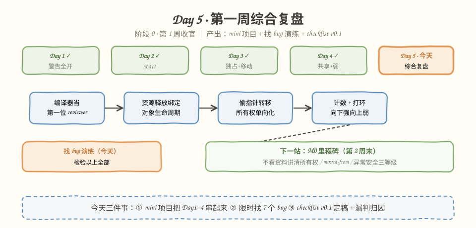
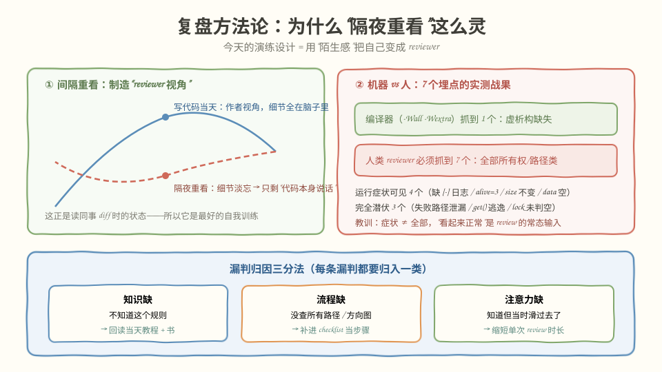
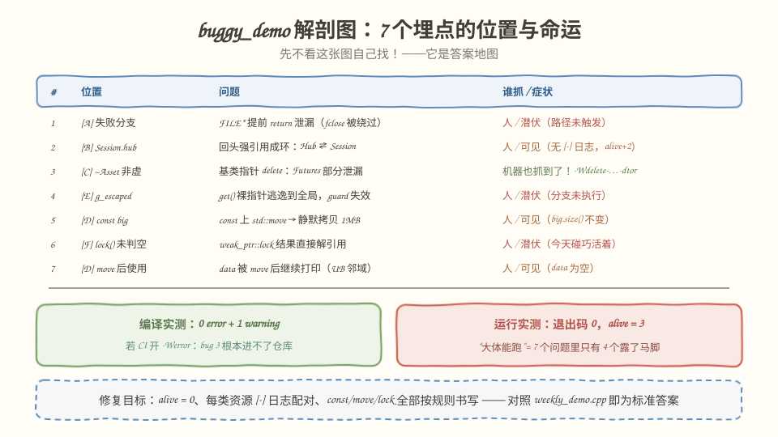

# Day 5 · 第一周综合复盘：mini 项目 + 找 bug 演练 + checklist v0.1

> **阶段 0 · 第 1 周收官** ｜ 当日计划：合并本周代码为一个 demo；隔一夜重读找 bug；checklist 写入 ≥10 条资源类条目
> 预计用时 60–90 分钟 ｜ 当日产出：weekly_demo + 7-bug 演练 + checklist v0.1 + 周记

## 导语

四天里你攒了一堆"知识零件"：警告全开、RAII、独占所有权、共享与弱引用。今天不学新东西，干三件事：**把零件拼成一台能跑的机器**（mini 项目），**用找 bug 演练检验它们是否真的长进了你的眼睛**，以及**把本周经验固化成 checklist v0.1**——从此它就是每次 review 前的"起飞检查单"。

复盘日的含金量常被低估。语言知识零散地放在脑子里时，它们只是"知道"；只有被一次实战检索过、错过、再修正过，才会变成"看见"。



*图 1：注意知识链最后那条虚线——它从 Day 4 弯回今天的演练。学习闭环的最后一环永远是"检验"，而不是"再读一遍"。*

## 前置补给

1. **间隔重看为什么有效**：写代码的当天，你对细节的记忆是"作者视角"（满分区）；隔一夜之后细节淡忘，重看时你被迫依赖代码本身的信息——这正是读同事 diff 时的状态。**用刻意制造的陌生感，把自己变成 reviewer。**
2. **机器 vs 人的分工**（今天的实测会给出真实数据）：编译器抓"语法与显式误用"，人抓"所有权、生命周期、路径覆盖、契约"。两者交集之外的问题，就是 review 存在的理由。

## 概念讲解：复盘日的三个动作

### 1. 合并：从零件到系统

单日示例各自验证一个点；合并后才会暴露**交互**问题——guard 与异常、池与独占、监视与弱引用在同一份代码里如何配合。[weekly_demo.cpp](examples/weekly_demo.cpp) 就是本周全部技术的会师。

### 2. 检验：限时找 bug

[buggy_demo.cpp](examples/buggy_demo.cpp) 是一个"大体能跑"的会话中心 + 资产快照系统，埋了 **7 个本周主题的问题**。规则：限时 20 分钟、只读代码、把发现写成 review 意见（带 Must/Should/Nit 级别），然后才能看答案。

### 3. 固化：漏判归因

每个漏判归入三类之一：**知识缺**（不知道规则→回读）、**流程缺**（没走步骤→补进 checklist）、**注意力缺**（知道但滑过去→缩短单次 review 时长）。归因决定改进动作，否则复盘只是自责。



*图 2：右侧是今天演练的真实战报——编译器在 7 个埋点中只抓到 1 个（虚析构），其余 6 个全部依赖人的判断。这就是"机器管机械、人管语义"的分界线。*

## 检视演练

> 环境同前：Apple clang 21.0.0，`-std=c++17 -Wall -Wextra -Wpedantic`。以下输出均为真实记录。

### 演练 1：mini 项目会师 —— [weekly_demo.cpp](examples/weekly_demo.cpp)

```bash
clang++ -std=c++17 -Wall -Wextra -Wpedantic weekly_demo.cpp -o weekly_demo && ./weekly_demo
```

实测输出：

```text
[1] 写报表（Day2+3：异常路径也落盘）：
    [file] fclose 已执行（异常路径也没漏）
    caught: 模拟中途异常
    重读报表: 有内容（落盘成功）
[2] 连接池（Day3：独占所有权）：
    [pool] 建立连接 行情源
    [pool] 建立连接 风险引擎
    池内有 2 个连接
    [pool] 关闭连接 风险引擎
    [pool] 关闭连接 行情源
[3] 会话监视（Day4：共享 + 弱引用）：
    [sess] 登录 alice
    [mon ] alice 在线
    [sess] 登出 alice
    [mon ] （会话已失效，weak_ptr 安全察觉）
[4] 全部作用域结束——每类资源的 [-] 日志都应配对出现：
main 结束
```

**0 告警、零泄漏、每类资源 [+] 与 [-] 日志严格配对**——这就是"标准答案的长相"。注意 `[2]` 里逆序关闭（风险引擎先于行情源）和 `[3]` 里 weak_ptr 对已销毁会话的安全察觉，都是本周学过的规律在系统里的自然涌现。

### 演练 2：限时找 bug —— [buggy_demo.cpp](examples/buggy_demo.cpp)

**现在停下：先花 20 分钟只读代码找问题、写下你的 review 意见，再继续往下看。**

写完了吗？先看编译器和运行环境的"战报"（真实记录）：

```bash
clang++ -std=c++17 -Wall -Wextra -Wpedantic buggy_demo.cpp -o buggy_demo
```

```text
buggy_demo.cpp:86:9: warning: delete called on non-final 'Asset' that has virtual
      functions but non-virtual destructor [-Wdelete-non-abstract-non-virtual-dtor]
   86 |         delete a;                        // 用基类指针删除派生对象
      |         ^
1 warning generated.
```

```bash
./buggy_demo        # 运行
```

```text
[A] 写快照文件：
    快照写入完成
[B] 会话中心：
  [+] Hub
  [+] Session alice
    内层作用域结束，Session 析构了吗？（看上方日志）
    Hub 作用域结束，析构了吗？（看上方日志）
[C] 资产删除：
  [+] Futures
    futures 保证金 5.2 亿
  [-] Asset（基类析构）
    delete 完成（Futures 的 [-] 日志出现了吗？）
[D] 快照数据处理：
    sink 收到 1048576 字节
    调用后 big.size() = 1048576
    sink 收到 12 字节
    之后还要用：data = ""（长度 0）
[E] 逃逸分支（默认不执行，供 review）：
[F] weak_ptr 使用：
  [+] Session bob
    locked->user = bob
  [-] Session bob
[G] 收尾：alive = 3（正确应为 0）
（退出码 0）
```

**先自评**：对照下面的答案，统计你找到几个、每个漏判归入哪一类（知识/流程/注意力）。

### 演练 3：答案与 review 意见（7 个埋点）



*图 3：7 个埋点的位置、可见性与"谁来抓"。其中 3 个完全潜伏——如果程序今天"看起来正常"你就放行，它们就是明年的生产事故。*

<details>
<summary><strong>点击展开：7 个埋点的答案、级别与修复方向</strong></summary>

1. **[A] `FILE*` 失败路径泄漏**（Must fix）——`SNAPSHOT_FAIL` 分支 `return 1` 绕过 `fclose`。机器不报（非 new 类资源），运行无症状（分支未触发）。修复：`unique_ptr<FILE, FileCloser>` 或今天 weekly_demo 的写法。*漏判归因参考：流程缺——没枚举所有出口。*
2. **[B] 循环引用**（Must fix）——`Session::hub` 是 `shared_ptr` 回头强引用，Hub⇄Session 成环：作用域结束后**双双无 [-] 日志**，alive +2。修复：`hub` 改 `weak_ptr`，访问时 `lock()`。*知识缺 or 流程缺——没画所有权方向图。*
3. **[C] 基类析构非虚**（Must fix）——`delete a`（`Asset*`）只执行 `~Asset`，`Futures::margin` 静默泄漏，alive +1。**这个 clang 抓到了**（`-Wdelete-non-abstract-non-virtual-dtor`；注意非多态场景的 `-Wnon-virtual-dtor` 默认不开，别指望编译器兜底）。修复：`virtual ~Asset()` = default。*如果漏了且没看警告：知识缺。*
4. **[E] `get()` 逃逸**（Must fix）——`g_escaped = g.get()` 把受保护句柄的裸指针存进全局，guard 析构后即悬垂（分支一旦执行就是 UAF）。修复：需要跨作用域持有就传 `unique_ptr` 所有权，或存 `weak_ptr` 思路的句柄表。*流程缺——没检查裸指针去向。*
5. **[D] `const` 上 `std::move`**（Should fix）——`big` 是 `const`，move 静默退化为**拷贝 1MB**；实测 `big.size()` 仍是 1048576。修复：去掉 const，或明确传 `const&` 不假装移动。*注意力缺——move 与 const 连用要多看一眼。*
6. **[F] `lock()` 未判空**（Should fix）——对象今天活着所以不崩，但会话一旦先失效，`locked->user` 就是空指针解引用。修复：`if (auto locked = w.lock()) {...}`。*流程缺——weak 三件套（判空/lock/用完即还）没走全。*
7. **[D] use-after-move**（Must fix）——`data` 被 move 后继续打印：实测为空串（libc++ 表现；标准说法是"有效但未指定"）。依赖此值是逻辑错误。修复：move 后不再使用，或需要副本就别 move。*知识缺——moved-from 语义没内化。*

**计分参考**：找到 6–7 个 = 第一周目标达成；4–5 个 = 正常，重点补漏判归因；≤3 个 = 把 Day 2–4 的"检视演练"小节重做一遍，下周继续（慢就是快）。
</details>

### 演练 4：checklist v0.1 定稿

把演练 2、3 的收获合并进常备文件——本日交付的种子版见 [my-review-checklist-v0.1.md](examples/my-review-checklist-v0.1.md)（12 条资源类 + 2 条工具类）。**每一条都应该让你想起一个具体的漏判或实验**，checklist 不是抄来的清单，是经验的索引。

## 工具验证

- weekly_demo：**0 告警**编译，运行零泄漏（日志配对完整）。
- buggy_demo：**1 条真实告警 + 退出码 0 + alive=3**。两个实验插曲也值得记住：把 `~Futures` 标 `override` 会直接编译错误（基类析构非虚时派生析构不能 override——bug 的连锁反应会自己冒头）；早先 `Asset` 为纯虚时 clang 直接在 `delete` 处生成陷阱指令（编译警告 + 运行 SIGTRAP 双拦截）。**结论：CI 开 `-Werror` 能把 bug 3 拦在仓库之外**——这正是 Day 55 的议题。
- 本日两个 demo 的运行输出已在演练中完整记录，可自行复跑对照（`snapshot.txt`/`weekly_report.txt` 生成在当前目录）。

## 常见错误与误判

1. **误判：复盘 = 再读一遍教程。** 重读只会强化"熟悉感"，检索（找 bug、默写规则）才强化"能力"。今天的主角是演练，不是阅读。
2. **误判：程序能跑就说明没漏。** 实测 7 个问题里 3 个完全潜伏、1 个只有日志级线索。review 的输入永远是"看起来正常"的代码。
3. **误判：漏判 = 我不行。** 漏判是数据不是评价。归因三类（知识/流程/注意力）→ 对应动作（回读/补 checklist/缩时间盒），这才叫复盘。
4. **坏习惯：checklist 抄网上的"大全"。** 别人的大全没有你的记忆锚点。从今天 14 条开始，每条都对应一次真实的发现或漏判。
5. **误判：找到 bug 就结束了。** 找到只是上半场；写出"对事不对人、带级别、可执行"的意见并验证修复，才是完整闭环（对照演练 3 的措辞）。

## 练习

1. **修复 buggy_demo**：按答案把 7 个问题全部修掉，验收标准——`-Werror` 编译通过、运行 `alive = 0`、每类资源 [+] [-] 配对、无 move/const 误用。（完成后可与 weekly_demo 对照结构。）
2. **给演练计时**：记录你 20 分钟内的"找 bug 产出曲线"（前 5 分钟找到几个？后 5 分钟呢？），写下你效率最高的阅读顺序（测试→接口→实现？）存进日记。
3. **写周记**：本周 5 天各用一句话总结；列出本周 checklist 新增条目数（目标 ≥10）；给自己的一句话评级（M0 预演：能否不看资料讲清所有权/moved-from/异常安全？）。
4. **预习挑战（可选）**：`std::string_view sv = "abc"; ` 和 `std::string_view sv2 = std::string("abc");` 哪个是隐患？下周见分晓。

## 验收清单

- [ ] weekly_demo 编译运行过，能指出输出中 3 处"本周规律"（逆序释放/异常落盘/weak 失效察觉）
- [ ] buggy_demo 限时 20 分钟完成，找到的数量与漏判归因已记录
- [ ] 7 个答案全部理解（尤其机器只抓到 1 个的原因）
- [ ] checklist v0.1 定稿：资源类 ≥10 条，每条有"来历"
- [ ] 周记已写（5 天总结 + 新增条目数 + M0 自评）
- [ ] review-diary.md 里有今天的找 bug 战绩：__ / 7

## 总结

第一周收官：你有了警告全开的环境、RAII 的直觉、所有权三分法（独占/共享/借用）的地图，以及一份带记忆锚点的 checklist v0.1。复盘日的核心产出不是代码，是**验证过的自己**——7 个埋点你抓到几个，比"感觉都懂了"诚实一万倍。

下周进入值语义与移动的世界：Day 6 从值类别（lvalue/rvalue）开始，Day 8 到完美转发，Day 10 收官于异常安全——第 2 周末的 M0 里程碑等着你：不看资料讲清三个核心概念。

---

*[返回教程索引](../README.md) ｜ 上一日：[Day 4 · shared_ptr 与 weak_ptr](../day-004/README.md) ｜ 下一日：Day 6 · 值类别与 decltype（待生成）*
