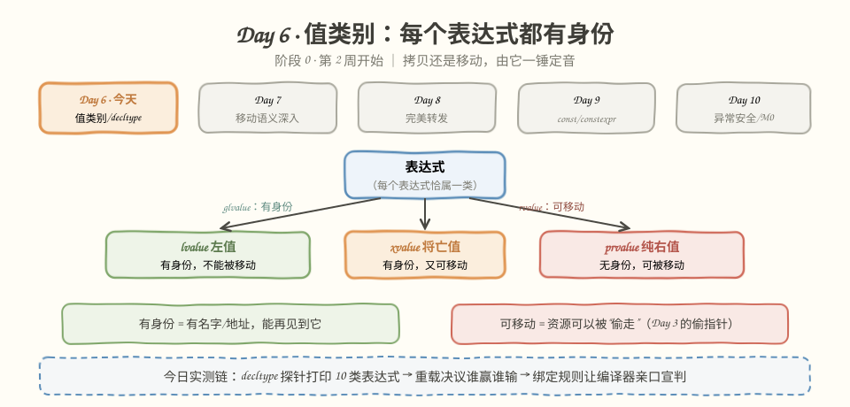
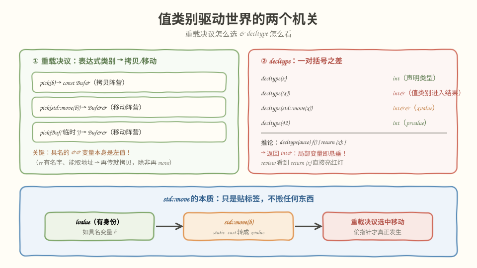
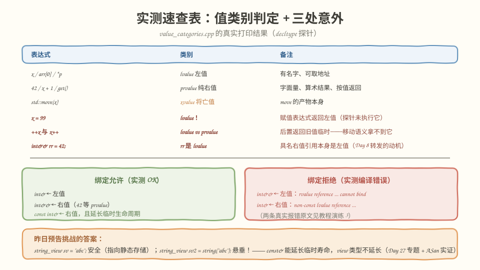

# Day 6 · 值类别与 decltype：每个表达式都有身份

> **阶段 0 · 第 2 周** ｜ 当日计划：学 lvalue / rvalue / xvalue；用 `decltype` 编译期打印验证各类表达式的值类别
> 预计用时 60–90 分钟 ｜ 当日产出：验证代码 + 值类别判定速查表

## 导语

先回答昨天留的预习挑战：

- `std::string_view sv = "abc";` —— **安全**。字符串字面量在静态存储区，view 指向的内存与程序同寿。
- `std::string_view sv2 = std::string("abc");` —— **悬垂**。右边的临时 `string` 在这条语句结束时销毁，而 **view 类型不延长临时的生命周期**（`const string&` 才有这个特权）。

为什么同样是"接住一个右值"，命运却不同？因为 C++ 对每个表达式都贴了一张看不见的标签——**值类别（value category）**。它决定引用能绑谁、重载决议选谁、`decltype` 看见谁。Day 3 你已经见过它的威力（`std::move` 贴标签触发移动构造）；今天系统地把它变成可查询、可验证的知识。



*图 1：C++11 起的官方分类是三维的：按"有身份"（glvalue）和"可移动"（rvalue）两个轴切出 lvalue / xvalue / prvalue 三类。xvalue 站在两个圆的交集上——既知道自己在哪，又允许被搬空。*

## 前置补给

1. **有身份（identity）**：有名字、能取地址、之后还能再见到它。`&x` 能写出来，就是有身份。
2. **可移动（movable）**：资源可以被"偷走"（Day 3 的偷指针），之后没人再读它的旧值。
3. **decltype 不求值**：`decltype((x = 99))` 只"看"表达式的类型，**不执行**赋值——今天的探针全靠这个特性，可以放心探测有副作用的表达式。

## 概念讲解

### 1. 探针怎么做：decltype 双括号技术

对表达式 `e`，`decltype((e))` 的结果直接暴露值类别：

| `decltype((e))` 结果 | e 的类别 |
|---|---|
| `T&` | lvalue（左值） |
| `T&&` | xvalue（将亡值） |
| `T`（无引用） | prvalue（纯右值） |

注意与**单括号**的区别：`decltype(x)` 给的是 x 的**声明类型**（`int`），只有 `decltype((x))` 才把"它是左值"这个事实带进结果（`int&`）。一对括号之差，是 C++ 著名的陷阱之一。

### 2. 值类别驱动重载决议

```cpp
const char* pick(const Buf&);   // 拷贝阵营
const char* pick(Buf&&);        // 移动阵营
```

调用点表达式的类别决定谁被选中：具名对象（lvalue）→ 拷贝；`std::move(b)`（xvalue）与 `Buf("...")`（prvalue）→ 移动。**你在 review 里关心的"这里发生拷贝还是移动"，本质上就是在问"这个实参是什么值类别"。**

### 3. std::move 与 decltype 的位置关系

`std::move(x)` 只是 `static_cast<T&&>(x)`：把左值**转换**成 xvalue，然后重载决议替你选择移动构造。所以"move 之后发生移动"是**间接的**——中间隔着标签和重载决议两道机关。这也解释了 Day 5 演练里 `const` 对象上 move 失效的原因：const 左值转出来仍是"不可移动"的，重载决议退回拷贝阵营。



*图 2：把这两张卡片放进脑子：左边回答"谁会被选中"，右边回答"decltype 看到了什么"。review 中 90% 的值类别问题都能靠它们现场推演。*

## 检视演练：三个实测

> 环境同前：Apple clang 21.0.0，`-std=c++17 -Wall -Wextra -Wpedantic`。输出均为真实记录。

### 演练 1：值类别探针 —— [value_categories.cpp](examples/value_categories.cpp)

```bash
./value_categories
```

实测输出：

```text
[1] 值类别探针（注意：decltype 不执行表达式，x 始终是 10）：
  x                      : lvalue  左值
  42                     : prvalue 纯右值
  x + 1                  : prvalue 纯右值
  std::move(x)           : xvalue  将亡值
  arr[0]                 : lvalue  左值
  *p                     : lvalue  左值
  x = 99                 : lvalue  左值
  ++x                    : lvalue  左值
  x++                    : prvalue 纯右值
  get()                  : prvalue 纯右值
[2] 值类别决定重载决议（拷贝 vs 移动）：
  pick(b)                 → const Buf&（拷贝阵营）
  pick(std::move(b))      → Buf&&（移动阵营）
  pick(Buf("临时对象"))    → Buf&&（移动阵营）
[3] 绑定规则（谁可以绑谁）：
  int&  ← x   ：OK（值 10）
  int&& ← 42  ：OK（值 42；注意 rr 自己是左值！）
  const int&←42：OK（值 42，临时活到了作用域结束）
```

四处"值得多看一眼"的实测结果：

- `x = 99` 是 **lvalue**（赋值表达式返回左值）——而且它**没有被执行**（探针不求值，x 保持 10）；
- `++x` 是 lvalue 但 `x++` 是 **prvalue**：后置自增返回旧值的临时副本——想给计数器类的 `operator++` 优化？前置版本才有资格被移动；
- `int&& rr = 42;` 之后 **rr 自己是左值**（有名字、可取地址）——再传给 `pick` 会进拷贝阵营。这正是 Day 8 完美转发要解决的问题；
- `const int&` 绑上 `42` 后临时**活到了作用域结束**（生命周期延长特例——只对 `const T&` 直接绑定生效，view 类型和经过函数返回的引用都没有这个待遇）。

### 演练 2：一对括号之差 —— [decltype_rules.cpp](examples/decltype_rules.cpp)

```bash
./decltype_rules
```

实测输出：

```text
[1] 一对括号之差：
  decltype(g)       是 int   ? 1
  decltype((g))     是 int&  ? 1
  decltype(move(g)) 是 int&& ? 1
[2] decltype(auto) 的返回类型陷阱：
  by_value()  → int（安全拷贝，值 1）
  by_parens() → int&（引用全局 g，值 1）
[3] 同样写法换成局部变量就是悬垂（仅说明，不运行 UB）：
  int local = 42; decltype(auto) r = (local); // r 是 int&
  函数返回后 local 销毁 → 悬垂。review 看到 return (x) 要亮红灯！
```

程序里还有四条 `static_assert`，**在编译期就锁死了这些结论**（运行前已验证）。`decltype(auto)` + `return (x);` 的组合会把返回类型悄悄变成引用——全局变量时"没事"，局部变量时就是悬垂引用。review 红灯规则：**`return (x);` 带括号直接问一句为什么**。

### 演练 3：让编译器亲口宣判绑定规则 —— [binding_error.cpp](examples/binding_error.cpp)

这个文件**故意写错**，编译它（预期失败）：

```bash
clang++ -std=c++17 -Wall -Wextra -Wpedantic binding_error.cpp -o binding_error
```

实测报错（真实原文）：

```text
binding_error.cpp:7:11: error: rvalue reference to type 'int' cannot bind to lvalue of type 'int'
    7 |     int&& a = x;    // ← 错误 1：右值引用不能绑定左值（x 有名字、可取地址）
      |           ^   ~
binding_error.cpp:8:10: error: non-const lvalue reference to type 'int' cannot bind to a temporary of type 'int'
    8 |     int& b = 42;    // ← 错误 2：非 const 左值引用不能绑定右值（42 是纯右值）
      |          ^   ~~
2 errors generated.
```

读报错的措辞：`cannot bind to lvalue` / `cannot bind to a temporary`——编译器内心就在用值类别思考。以后看到这类报错，先把表达式分类画出来，答案自然浮现。



*图 3：上半部分是可直接抄进笔记的判定速查表；下半部分是绑定规则的两栏对照（允许 vs 拒绝）。红色标注的四处是今天最反直觉的实测发现。*

## 工具验证

- 三个示例：两个正常示例 **0 告警**；`binding_error.cpp` 按预期**编译失败**（2 条错误即其功能）。
- `static_assert` 是把"值类别知识"变成**编译期契约**的手段——今天的断言若被未来修改打破，构建直接失败。给自己项目里的关键类型约定加几条，是低成本高回报的防御。
- 探针宏 `CAT(expr)` 用了宏的字符串化（`#expr`）+ decltype 双括号，这个模式可以复制到你自己的实验里探测任意 int 系表达式。

## 常见错误与误判

1. **误判：值类别就是"左值右值"二分。** C++11 后是三分：lvalue / xvalue / prvalue，且"有身份"与"可移动"是两个独立维度。xvalue（如 `std::move(x)` 的结果）两样都占。
2. **误判：`std::move` 之后一定发生了移动。** move 只贴标签；真正搬东西要等重载决议选中移动构造。中间任何一环不配合（如 const、如目标类型没有移动构造），就退回拷贝甚至编译失败。
3. **误判：`int&& rr = 42;` 里的 rr 是右值。** **具名**右值引用是左值。匿名的才保持右值身份。
4. **误判：`const T&` 延长生命周期是通则。** 它只对"直接绑定临时"这一个姿势生效。`string_view`、函数返回的 `T&`、绑定到 `auto&&` 再转发的场景都不享受——Day 27 会用 ASan 实证 view 的悬垂。
5. **陷阱：`decltype((x))` 与 `decltype(x)`。** 一对括号把"值类别"带进结果。配合 `decltype(auto)` 时，`return (local);` 会静默返回引用——review 时对带括号的 return 保持警觉。
6. **误判：`x++` 和 `++x` 差不多。** 类别上差一个档次：前置返回左值、后置返回 prvalue（旧值副本）。迭代器循环里 `it++` 每次多构造一个临时迭代器——这也是"惯用 `++it`"背后的值类别解释。

## 练习

1. **扩展探针**：在 `value_categories.cpp` 里再加 5 个表达式探测并预测后验证：`x * 2`、`arr`（数组名本身）、`"hello"`（字符串字面量，提示：不是 int 系，需要给 `Cat` 加 `const char(&)[6]` 特化）、`std::forward<int&>(x)`、逗号表达式 `x, 42`。
2. **预测-验证**：不跑代码，写下 `pick(std::move(rr))`（rr 是 `int&&`？换成 `Buf&&` 场景）会进哪个阵营；再改代码验证。
3. **review 实操**：审这三行并写意见——`const std::string& name() const;`（返回成员的 const 引用，安全）；`decltype(auto) name() { return (name_); }`（返回带括号——引用成员没问题，但风格上留雷）；`std::string_view nick() { return first_ + last_; }`（返回局部临时的 view——Must fix，悬垂）。写完记录你依据的是今天哪条规则。
4. **口述检验**：向空气解释"为什么 `void f(Widget&& w);` 调用 `f(b)` 编译不过，而 `f(std::move(b))` 可以"，全程只用"身份/可移动"两个词。

## 验收清单

- [ ] 能画出三分法树状图并解释 xvalue 为什么站在交集上
- [ ] 探针跑过，速查表抄进笔记（含三处意外：赋值是左值、x++ 是纯右值、具名 && 是左值）
- [ ] 亲眼见过 `decltype((g))` 与 `decltype(g)` 的一对括号之差（含 static_assert）
- [ ] 见过两条真实绑定报错并能翻译成值类别语言
- [ ] 能复述 `const T&` 延长生命周期的**适用边界**（view 不延长）
- [ ] Day 5 的预习挑战已理解并在日记里写清原因

## 总结

今天你拿到了 C++ 类型系统的"底层户口查询工具"：任何表达式先问类别，再推断绑定、重载、移动的走向。review 时这变成一个快速反射——**看到 `&&` 参数、`std::move`、`decltype(auto)`、带括号的 return，先在心里给表达式过一遍户口**。

明天 Day 7 深入移动语义的腹地：moved-from 状态的完整语义、移动构造/赋值的正确写法（自赋值防护、noexcept 的分量）、以及"哪些类型根本不该有移动"。

---

*[返回教程索引](../README.md) ｜ 上一日：[Day 5 · 第一周综合复盘](../day-005/README.md) ｜ 下一日：Day 7 · 移动语义深入（待生成）*
