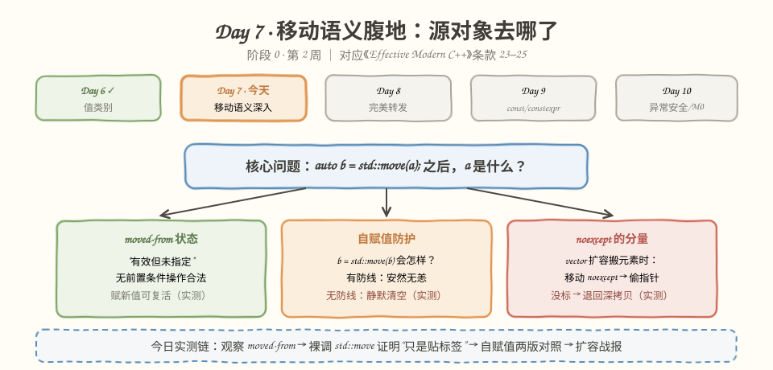
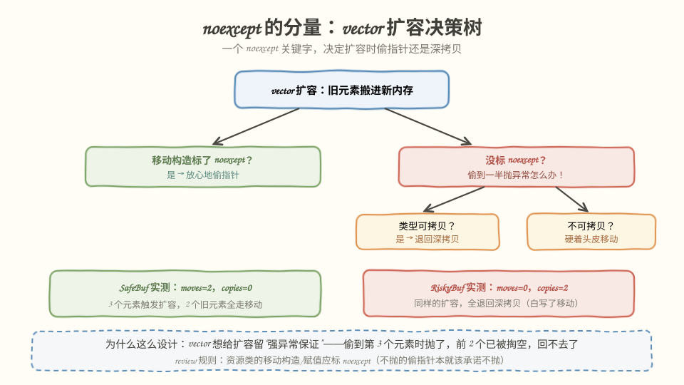
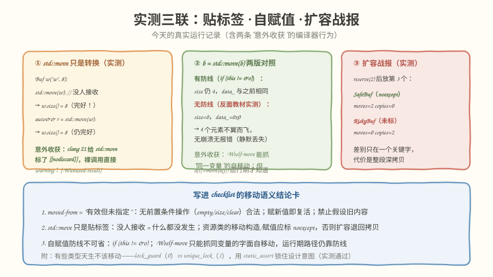

# Day 7 · 移动语义深入：moved-from、自赋值与 noexcept

> **阶段 0 · 第 2 周** ｜ 当日计划：读《EMC++》条款 23–25；写可移动类观察 moved-from 状态；验证 `std::move` 只是类型转换
> 预计用时 60–90 分钟 ｜ 当日产出：4 个实测示例 + 移动语义结论卡

## 导语

昨天你拿到了值类别的"户口查询工具"。今天钻进移动语义的三个腹地，它们正好对应三个 review 高频问题：

1. **`auto b = std::move(a);` 之后，`a` 到底是什么？**（答完这个，你才知道 use-after-move 该怎么审）
2. **`b = std::move(b);` 会发生什么？**（自赋值——写出防线之前，先看看没防线的下场）
3. **移动构造上那个 `noexcept` 有多重？**（一个关键字的缺席，能让 vector 扩容整段退回深拷贝）

三个问题都有实验可做、有真实输出可看。今天还有两条**意外收获**：clang 21 居然给 `std::move` 标了 `[[nodiscard]]`，裸调用直接告警；`-Wself-move` 能抓同变量的自移动——机器的边界又向外扩了一小圈，但边界外依然是人的战场。



*图 1：三个问题分别对应 moved-from 语义、赋值防线、noexcept 分量。它们是"写对移动"和"审出移动问题"的同一套知识。*

## 前置补给

1. **moved-from（被移后）状态**：标准库类型的约定是"**有效但未指定**（valid but unspecified）"——对象没坏，但内容未知。合法操作：无前置条件的（`empty()`、`size()`、`clear()`）、赋新值、析构；非法操作：假设它还有旧内容。
2. **自赋值（self-assignment）**：`x = x` 听起来傻，但 `a[i] = a[j]`（i==j）、`*p = *q`（p==q）在运行期就会变成它——**写赋值运算符时无法排除这种调用**。
3. **强异常保证（strong exception guarantee）**：操作失败时对象保持原状。vector 扩容想要它：搬迁途中抛异常，旧数据必须完好——这直接决定了今天的主角剧情。

## 概念讲解

### 1. std::move 只是贴标签（第三次、也是最彻底的一次验证）

`std::move(w)` 是 `static_cast<T&&>(w)`：**转换本身不搬任何东西**。搬运发生在"贴了标签的值被交给移动构造/赋值"那一刻。两个推论（今天实测）：裸调用（结果没人接收）什么都不会发生；绑定到 `auto&&` 引用也不发生。

### 2. 移动赋值的四步正确写法

```cpp
Buf& operator=(Buf&& o) noexcept {
    if (this != &o) {        // ① 自赋值防线
        delete[] data_;      // ② 清理自己的旧资源
        data_ = o.data_;     // ③ 偷对方的
        o.data_ = nullptr;   // ④ 置空对方（它只剩析构）
    }
    return *this;
}
```

顺序有讲究：先 ① 再 ②——否则自赋值时会先把自己的资源删了，后面全是在读尸体。

### 3. noexcept：移动构造的"资格证"

vector 扩容要搬旧元素。搬哪个？标准通过 `std::move_if_noexcept` 决策：**移动构造是 noexcept → 偷指针；否则若类型可拷贝 → 深拷贝**。理由是强异常保证：偷到第 3 个元素时移动构造抛了，前 2 个已被掏空、新数组半成品、旧数组千疮百孔——回不去了。而拷贝失败可以直接扔掉新数组。



*图 2：决策树的实测战报在下方两栏。review 规则一句话：**资源类的移动构造/赋值应当 noexcept**——不抛的偷指针，本就该承诺不抛。*

## 检视演练：四个实测

> 环境同前：Apple clang 21.0.0，`-std=c++17 -Wall -Wextra -Wpedantic`。输出均为真实记录。
> 预期内的告警共 3 条（各有教学意义，见各演练），`noexcept_move.cpp` 0 告警。

### 演练 1：moved-from 状态观察 —— [moved_from_state.cpp](examples/moved_from_state.cpp)

```bash
./moved_from_state
```

实测输出：

```text
[1] 观察 moved-from（我们的实现选择“置空”）：
    移动后：a.empty() = 1, a.size() = 0
            b.size() = 8（资源已归 b）
[2] moved-from 对象的合法操作（标准保证）：
    a.empty() = 1（无前置条件 → 合法）
    复活后：a.size() = 4（赋新值 = 认可的复活）
[3] 复活对象照样进容器：
    容器内 2 个 Buf；a.empty() = 1
[4] std::move 只是类型转换（不交给任何人就什么都没发生）：
    裸调用 std::move(w) 后：w.size() = 8（完好）
    绑定 auto&& 后：w.size() = 8（仍完好）
[5] 编译期检查：有些类型天生不许移动：
    lock_guard 可移动？0 ｜ unique_lock 可移动？ 1
```

读点：`a` 被 move 后在我们**自己的实现**里是空（这是实现选择，标准只说"未指定"）；`empty()/size()` 这类无前置条件操作**合法**；`revive()` 赋新值后对象完全复活、还能再次被 move 进容器。[4] 是"贴标签"的终极验证：裸调用和绑定引用都没搬走任何东西。**注意编译时有一条真实告警**——clang 21 给 `std::move` 标了 `[[nodiscard]]`：

```text
moved_from_state.cpp:62:5: warning: ignoring return value of function declared with
      'nodiscard' attribute [-Wunused-result]
   62 |     std::move(w);      // 转换结果没人接收 → 无任何效果
```

编译器在替你问："这个 move 的结果你打算给谁？"——把它当成免费的 review 意见收下。

[5] 用 `static_assert` 锁住两个设计事实：`lock_guard` **不可移动**（把锁移动出临界区 = 灾难，所以标准库直接禁了）；`unique_lock` 可移动（它为此而生：可移交、可提前 unlock、可延迟加锁）。"该不该有移动"本身也是设计 review 题。

### 演练 2：自赋值防线 —— [self_assignment.cpp](examples/self_assignment.cpp) 与反面 [self_assignment_bad.cpp](examples/self_assignment_bad.cpp)

```bash
./self_assignment
```

```text
[1] 正常移动赋值：
    [赋值] x 接管 y 的资源
    x.size() = 8, y.size() = 0
[2] 自赋值：b = std::move(b)：
    [赋值] 检测到自赋值，跳过（b 安然无恙）
    自赋值后：b.size() = 4, data_ 与之前相同？1
```

反面教材（无防线版）：

```bash
./self_assignment_bad
```

```text
[前] b.size() = 4, data_ = 0x101029160
    [赋值] 进入（this=0x16f30ad20, &o=0x16f30ad20，同一个？1）
[后] b.size() = 0, data_ = 0x0
     自移动赋值后：4 个元素不翼而飞（size=0，data_=空）
     无崩溃、无运行期报错——静默数据丢失
     （若成员顺序不同，还可能出现“size 撒谎”或双重释放等别的坏法）
```

对照结论：**同一个 `b = std::move(b)`，有防线安然无恙，无防线静默清空**——不崩溃、不报错、数据没了。这是最难审的一类 bug（没有任何症状供你复现）。另一个真实发现：clang 的 `-Wself-move`（本次实测两条）能抓"**同一变量**的字面自移动"，但 `a[i] = std::move(a[j])`（i==j 只有运行期知道）依然只有防线能救——机器抓语法，人审路径。

### 演练 3：noexcept 的分量 —— [noexcept_move.cpp](examples/noexcept_move.cpp)

```bash
./noexcept_move
```

实测输出：

```text
[1] SafeBuf（移动构造 noexcept）：
    扩容前：moves = 0, copies = 0
    扩容后：moves = 2, copies = 0  ← 全部偷指针
[2] RiskyBuf（移动构造未标 noexcept）：
    扩容前：moves = 0, copies = 0
    扩容后：moves = 0, copies = 2  ← 退回深拷贝！
[3] 为什么：vector 要给扩容留“强异常保证”：
    搬到第 3 个元素时移动构造抛了怎么办？前 2 个已被掏空，回不去了
    → 标准规定：移动不 noexcept 且可拷贝时，扩容退回拷贝（move_if_noexcept）
```

两个结构除关键字外**完全相同**：SafeBuf 的移动构造标了 `noexcept`，扩容时 2 个旧元素全部走移动（moves=2）；RiskyBuf 没标，同样场景退回 2 次深拷贝（copies=2）。想象元素是 1MB 的缓冲区，这就是 2MB 的无谓复制——**一个关键字的缺席，性能悄悄腰斩**。review 时看到"写了移动构造却没标 noexcept 的资源类"，直接 Should fix。



*图 3：三个实验的证据 + 底部结论卡。结论卡可直接抄进 checklist。*

## 工具验证

- 编译状态（真实记录）：`noexcept_move.cpp` **0 告警**；`moved_from_state.cpp` 1 条预期内告警（`-Wunused-result`，即 [[nodiscard]] 教学）；`self_assignment*.cpp` 各 1 条预期内告警（`-Wself-move`，本身就是教学点）。
- 计数器法（static inline int）是量化"移动 vs 拷贝"的最轻量手段，可以搬进任何性能怀疑现场。
- 预告：Day 43 会系统讲 noexcept（析构函数隐式 noexcept、noexcept 与 terminate）；今天的"扩容联动"是它最贵的应用场景。

## 常见错误与误判

1. **误判：被 move 的对象"坏了"，只能扔。** 它是"有效但未指定"：`clear()`、赋新值、再 move、析构都合法。真正的红线只有一条——**假设它还留着旧内容**。
2. **误判：`std::move(w);` 单独一行也算"移动了 w"。** 只是转换（实测 w 完好）。clang 21 还会用 [[nodiscard]] 告警提醒你。
3. **误判：自赋值检查是过度防御。** `a[i] = std::move(a[j])` 一行就能让防线变成必需品。反面教材实测：没防线时静默清空、无任何症状。
4. **误判：noexcept 只是文档。** 它参与重载决议与 `move_if_noexcept` 决策——扩容实测：标了走移动、没标退拷贝。对资源类是**实打实的性能开关**。
5. **误判：所有类都该提供移动。** `lock_guard` 故意不可移动（移出临界区 = 灾难）。"禁掉移动"也是设计表达——用 `= delete` 或不声明，并配 static_assert 锁住意图。
6. **误判：标 noexcept 就完事了。** noexcept 函数里抛异常 = `std::terminate` 直接崩溃。承诺前确认移动路径真的不抛（偷指针不分配，通常安全；但移动一个会分配的成员就可能抛）。

## 练习

1. **破坏性实验**：把 `moved_from_state.cpp` 里 `revive()` 之后改成直接读 `a` 的内容（假设它还有旧数据），观察"有效但未指定"在实践中意味着什么（我们的实现是空，别的实现可能是别的）。
2. **补全四步**：给 Day 3 的 `Buffer` 补上带防线、带 noexcept 的移动赋值，并用 `self_assignment.cpp` 的模式测试 `b = std::move(b)`。
3. **review 实操**：审这段代码——`struct Page { Page(Page&&) { ... } };`（移动构造未标 noexcept，Page 含 64KB 缓冲）+ `std::vector<Page> hot_pages;`。参考意见：Should fix——"Page 的移动构造不抛应标 noexcept；否则 hot_pages 扩容会对每个 64KB 页走深拷贝（move_if_noexcept 退回拷贝），热路径上代价放大 N 倍"。
4. **口述检验**：解释"为什么 vector 在移动不 noexcept 时宁可拷贝"，用"搬到一半抛了"把故事讲完整。

## 验收清单

- [ ] 能说出 moved-from 的三个合法操作与一条红线
- [ ] 亲眼验证过"裸调用 std::move 什么都没发生"（含 [[nodiscard]] 告警的解读）
- [ ] 见过自赋值两版对照的实测（安然无恙 vs 静默清空）
- [ ] 见过扩容战报（moves=2/copies=0 vs copies=2），能解释 move_if_noexcept
- [ ] 结论卡三条已写进 checklist；练习 3 的 review 意见已写进日记
- [ ] 能举一个"天生不该移动"的类型并说明理由

## 总结

今天把移动语义从"会用"推进到"会审"：moved-from 的合法边界（use-after-move 的判定标准）、自赋值防线（静默数据丢失的唯一保险）、noexcept 资格证（一个关键字换一整段深拷贝）。加上两条意外收获（[[nodiscard]] 与 -Wself-move），你对"机器能抓什么"的地图又精确了一点。

明天 Day 8 处理移动语义的最后一块拼图：**完美转发**——`std::forward`、引用折叠、以及"具名右值引用是左值"这个昨天埋下的伏笔如何被 `T&&` 模板参数优雅化解。

---

*[返回教程索引](../README.md) ｜ 上一日：[Day 6 · 值类别与 decltype](../day-006/README.md) ｜ 下一日：Day 8 · 完美转发（待生成）*
